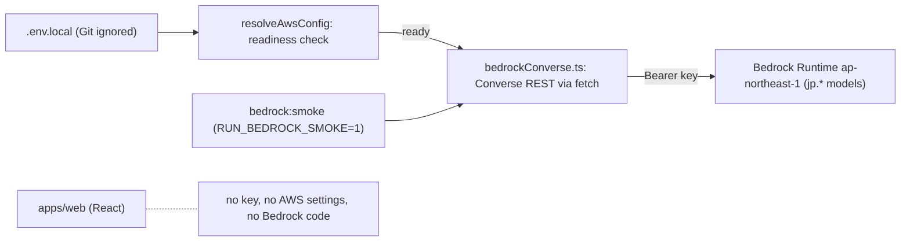

# Design Document

## Overview

本designは、`requirements.md`の6要件を、すでに実装済みのコードに対応づけて整理する。新しい処理は追加しない。実装済みの設定検査、Converseクライアント、スモークコマンドが管理者のBedrock APIキー利用ガイドに合っていることを示し、残りの作業を明確にする。

| 方針 | 内容 |
| --- | --- |
| 認証 | Bedrock APIキーをBearer認証で送る。AWS CLI、SSO、AWSプロファイル、IAM、STS、AWS SDKは使わない |
| 場所 | Bedrockを呼ぶのは`apps/api`（Express、サーバー側）だけ。`apps/web`はキーも設定も持たない |
| 保存 | キーはGit管理外の`.env.local`だけ。`.env.example`は設定名のみ |
| 制限 | 入力、出力、同時実行、回数、時間の上限をクライアントで強制する |
| 既存仕様 | `ehime-vote-navigator`は編集しない。上書き対象は下の表のとおり |

## Architecture



## Components and Interfaces

| ファイル | 役割 |
| --- | --- |
| `packages/contracts/src/aws-config.ts` | 設定名、`jp.`許可と他の推論プロファイルの拒否、`ReadyAwsConfig`（キーの値を持たない） |
| `apps/api/src/config/aws.ts` | `resolveAwsConfig`と`withReadyAwsConfig`。キーは存在だけを確認し、値は保持しない |
| `apps/api/src/aws/bedrockConverse.ts` | Converse APIの呼出し。許可モデル、上限、BUSY、RATE_LIMITED、タイムアウト、再試行なし |
| `apps/api/src/aws/bedrockSmoke.ts`、`smoke.ts` | `RUN_BEDROCK_SMOKE=1`のときだけ1回送るスモーク |
| `apps/api/package.json`、`package.json` | `bedrock:smoke`。`node --env-file-if-exists=../../.env.local`でキーを読み込む |
| `.env.example` | 設定名のみ（キーは空） |

## 上書きする既存基準

| 既存の基準 | 本featureでの扱い |
| --- | --- |
| 14.1 AWSプロファイルの既定値 | プロファイルは使わない。未設定でも要求しない |
| 14.3 cross-Region inferenceの無効 | 日本国外へ送る形式は拒否し、日本国内の`jp.`だけを許可する |
| 14.5、14.6 3用途のモデルID必須 | 生成と意味判定が必須、埋め込みは任意。不足の表示にキー名を含める |
| 14.9 認証は既定チェーンまたはSSO | Bedrock APIキーをサーバー側の環境変数から読む |
| 14.11 アクセスキー等の出力禁止 | Bedrock APIキーを同じ禁止対象に加える |
| 14.12 認証情報欠落時にSSOを案内 | `.env.local`の設定と管理者への連絡を案内する |
| 14.15、14.16 AWS読み取り診断（STS） | 設定検査とスモーク要求に置き換える |
| Task 7.1 | `jp.`を許可、キー必須、埋め込み任意 |
| Task 7.3 | STS診断は行わない |
| Task 7.4 | Port分離と埋め込みを除き、Converse呼出しは実装済み |
| Task 7.5 | 3用途ではなく2モデルのスモーク（未着手のままの`ehime-vote-navigator`側とは別に実装済み） |

## 実装状況

| 項目 | 状況 |
| --- | --- |
| 設定検査とテスト | 実装済み |
| Converseクライアントとテスト（fake `fetch`） | 実装済み |
| スモークコマンド | 実装済み |
| GenerationPort、SemanticVerificationPort、fake adapter契約テスト | 未実装（`ehime-vote-navigator`のTask 7.4の残り。進行中） |
| 埋め込みアダプタ | 未実装（今回の最小構成では不要） |
| `ehime-vote-navigator`のTask 7.5（3用途スモーク） | 未着手 |
| 未使用の`@aws-sdk/*`依存の整理 | 未実施（`tests/harness/network-guard.ts`が参照） |

## Data Models

型は`packages/contracts/src/aws-config.ts`と`apps/api/src/aws/bedrockConverse.ts`にある。要点だけを示す。

```ts
// 準備状態: Bedrock APIキーの値は持たない
type ReadyAwsConfig = {
  profile: string;            // 既定値の表示用。認証には使わない
  region: "ap-northeast-1";
  crossRegion: false;
  models: { generation: string; verification: string; embedding: string | null };
};
type AwsConfigNotReady = {
  missing: Array<"AWS_BEARER_TOKEN_BEDROCK" | "BEDROCK_GENERATION_MODEL_ID" | "BEDROCK_VERIFICATION_MODEL_ID">;
  violations: Array<{ code: string; name: string }>;   // 設定名と固定コードのみ。値は含めない
};

// Converse呼出しの結果: 本文は呼出し側にだけ返し、エラーには含めない
type BedrockConverseSuccess = { text: string; status: number; elapsedMs: number };
type BedrockConverseError =
  | { code: "CONFIG_NOT_READY"; notReady: AwsConfigNotReady }
  | { code: "HTTP_ERROR"; status: number }
  | { code: "INPUT_INVALID" | "INPUT_TOO_LONG" | "MODEL_NOT_ALLOWED" | "TOKEN_INVALID"
        | "BUSY" | "RATE_LIMITED" | "TIMEOUT" | "NETWORK_ERROR" | "RESPONSE_INVALID" };
```

設定は環境変数から読み、保存しない。永続化するデータは増えない。
## Correctness Properties

### Property 1: 準備状態の判定

For any 環境変数の組合せ、設定検査はキー、生成モデルID、意味判定モデルIDが揃い、形式と`ap-northeast-1`が正しいときだけreadyを返し、それ以外では欠けた設定名と違反コードだけを返す。値は返さない。

**Validates: Requirements 1.5, 2.3, 2.5, 3.1, 3.2, 3.3, 3.4**

### Property 2: 許可外の要求は送信されない

For any モデルID、長すぎる入力、上限を超える同時実行と回数の要求、Bedrockクライアントは`fetch`を呼ばずに固定コードで失敗する。

**Validates: Requirements 2.1, 2.2, 6.1, 6.3, 6.4**

### Property 3: 秘密情報が出力されない

For any 失敗した要求と成功した要求、戻り値、エラー、ログにキー、リクエスト本文、応答本文が含まれない。

**Validates: Requirements 1.2, 5.1, 5.2, 5.3**

既存のテストとの対応: `apps/api/src/config/aws.property.test.ts`（Property 1）、`bedrockConverse.property.test.ts`（入力長の上限）、`bedrockConverse.test.ts`（許可モデル、BUSY、RATE_LIMITED、再試行なし、秘密情報）。上のProperty 2の同時実行と回数、およびProperty 3は現時点では例示テストで確認しており、property testへの拡張は`tasks.md`に残している。

## Error Handling

| 領域 | コード | 結果 |
| --- | --- | --- |
| 設定 | `CONFIG_NOT_READY`（不足する設定名、違反コード） | Bedrock要求0回 |
| 入力 | `INPUT_INVALID`、`INPUT_TOO_LONG`、`MODEL_NOT_ALLOWED` | 送信しない |
| 認証 | `TOKEN_INVALID`、HTTP 401/403（`HTTP_ERROR`＋ステータス） | キーと本文を含めずに返す |
| 制限 | `BUSY`、`RATE_LIMITED`、`TIMEOUT` | 待機も再試行もしない |
| 応答 | `NETWORK_ERROR`、`RESPONSE_INVALID`、`HTTP_ERROR` | 固定コードとステータスのみ |

## Testing Strategy

通常のテストはfake `fetch`と一時ディレクトリだけを使い、ネットワークとBedrockを呼ばない。実際のBedrock呼出しは、利用者が`npm run bedrock:smoke`を明示的に実行したときの1回だけである。property testはfast-checkで100回以上実行する。