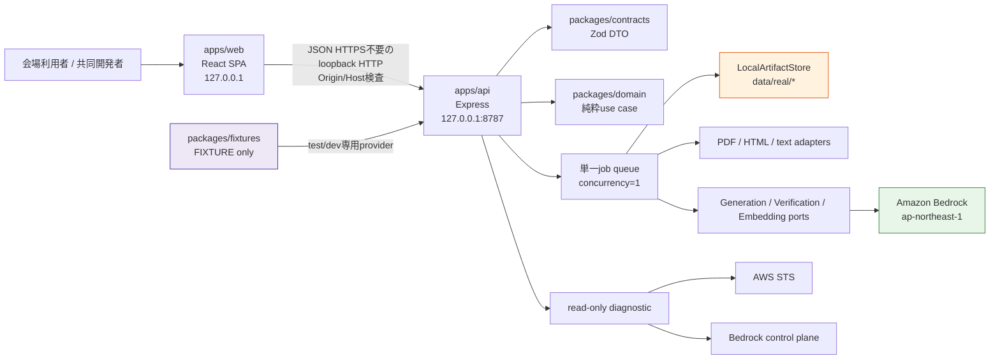
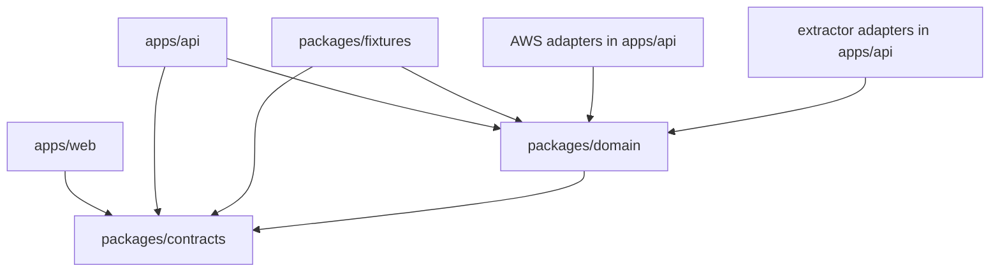
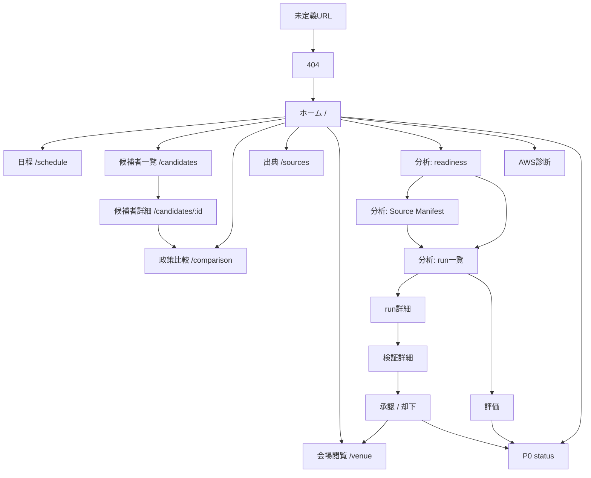
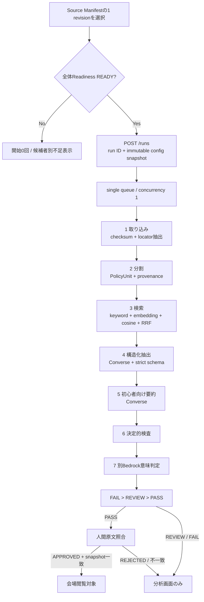
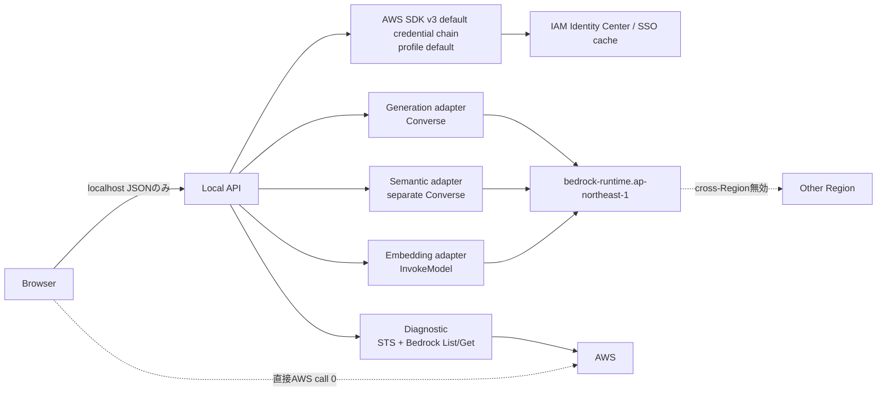

# Design Document

## Overview

### 目的と完成境界

「えひめ投票ナビ」は、令和4年（2022年）第20回愛媛県知事選挙を対象に、実在する政策一次資料の取り込み、Amazon Bedrockによる埋め込み・構造化抽出・初心者向け要約・意味判定、決定的な根拠検証、人間承認、候補者表示、承認済み政策比較を実演するローカル限定デモである。P0は日本標準時の2026-11-16 00:00より前に完成判定を終える。アプリケーションは開発端末のloopback interfaceだけで動かし、インターネット上の一般公開endpointを作らない。

対象選挙IDは `ehime-governor-2022-20`、対象候補者は中村時広氏と林紀子氏の2名に固定する。全画面に「会場ローカルデモ・一般公開ではありません」と過去選挙表示を出す。実資料由来の画面には「2022年実資料・AI解析」、fixture画面には「架空fixture・UIテスト専用」を表示し、両者を同じ画面またはrunで混在させない。

P0は次を含む。

- Source Manifest、同等資料範囲、両候補者の `READY` gate
- PDF、HTML、UTF-8 textのlocator付き取り込み
- 決定的keyword検索、Bedrock embedding、ローカルcosine、順位融合による最小Hybrid RAG
- Bedrockによるstrict JSON構造化抽出と300 code point以下の初心者向け要約
- 決定的検査と、生成要求とは別のBedrock意味判定
- `PASS` と `APPROVED` を分離した人間承認およびsnapshot一致による公開gate
- 会場閲覧画面、ローカル分析画面、実行履歴、費用記録、gold dataset評価、P0完成判定
- Windows上の新しい作業用コピーから再現できるweb/API起動と終了する検査command

P1の当日投票所検索、期日前投票所検索、根拠付きAI質問チャット、投票方法ガイドはP0完成後に別featureとして有効化する。P2の3D、通知、読み上げ、文字倍率、カレンダー、政治用語解説は2026-11-15後に着手する。P0のroute、bundle、依存関係にはThree.js、Notification API、Web Speech API、calendar連携を含めない。P1/P2の状態はP0完成判定へ入力しない。

### 現在の資料状態とfail-closed方針

設計更新時点では、2022年選挙について両候補者へ同じ採用規則を適用できる政策一次資料が未入手である。愛媛県の公式結果ページと知事選挙の歩みは、投票日と候補者を確認する一次情報として使うが、政策本文の代替にはしない。2026年の第21回特設サイト、現在の候補者サイト、片方だけの政策資料、出典不明資料、AI生成文、fixtureを欠落資料の代替にしない。

この状態でもschema、API、extractor、検索、Bedrock adapter、検証、承認、UIをfixtureとfake adapterで構築できる。ただし、実Source Manifestが両候補者の同等資料範囲を満たすまで `ReadinessStatus` は `NOT_READY` であり、実AI run開始、通常政策要約、政策比較、`P0完成` は必ず拒否する。`npm run p0:check` は現状を隠さず未達項目と証跡不足を返す。

### 設計原則

1. **正本優先**: `requirements.md` の語彙、状態、P0/P1/P2境界を実装契約へ直接写す。
2. **少量・単一端末に合わせる**: npm workspaces、Node.js API、ローカルJSONを採用し、P0にDynamoDB、OpenSearch、S3、Lambda、API Gateway、Amplifyを追加しない。AWS接続はBedrock control plane、Bedrock Runtime、および呼出主体確認用STSに限定する。
3. **fail closed**: 資料、来歴、schema、根拠、承認snapshot、データ種別のどれかを確認できなければ、推測や別版へのfallbackをせず非公開にする。
4. **AIと規則を分離する**: 生成、意味判定、embeddingを別portにし、決定的検査をAI判定から独立させる。
5. **外部送信を限定する**: 原文、根拠引用、構造化情報、要約は設定したBedrock modelへ必要な段階だけ送る。住所、現在地、P1質問、AWS認証情報はP0 runへ入れない。
6. **中立な表示**: 候補者へ同じ採用規則、schema、項目、欠損表現、カード寸法、表示順規則を適用する。推薦、独自採点、ランキング、根拠にない政治分類を作らない。
7. **追跡可能性**: source byteから公開画面まで `electionId`、`candidateId`、`sourceId`、`revision`、`sourceChecksum`、`locator`、`runId` を切らさない。
8. **再実行より再現性**: run開始時の設定を固定し、保存済みembedding、prompt版、model ID、価格表版を履歴に残す。無制限retryや暗黙のリージョン変更をしない。
9. **既存資産を破壊しない**: `.git`、既存Git履歴、`.kiro`、spec IDを保持する。READMEは内容を本機能向けに更新するが、履歴や設定を削除して作り直さない。

### 技術調査と設計への反映

- 愛媛県の[令和4年 第20回愛媛県知事選挙の結果](https://www.pref.ehime.jp/e60700/r4chijisen.html)と[知事選挙の歩み](https://www.pref.ehime.jp/e60700/1696/ayumi.html)を、対象選挙、投票日、候補者、氏名表記の確認元にする。2026年の[候補者等情報特設ページ](https://senkyo.pref.ehime.jp/kouhosya/)は別選挙sourceとしてdenylistへ登録する。
- 愛媛県の[リンク・著作権・免責事項等](https://www.pref.ehime.jp/page/14959.html)は、県サイトの写真、画像、文章等に権利があることを示している。この一般ページだけで個別政策資料の再配布可否を `CONFIRMED` にせず、資料単位で確認日、確認対象、根拠を記録する。
- [npm workspaces](https://docs.npmjs.com/cli/v10/using-npm/workspaces)は単一rootからローカルpackageを関連付け、workspace単位または全体のscriptを実行できる。2人がweb、API、共有契約を分けつつ1つのlockfileで固定する構成に使う。
- [Bedrock Converse API](https://docs.aws.amazon.com/bedrock/latest/userguide/conversation-inference.html)はmessage対応modelへ共通interfaceを提供するため、generationとsemantic verificationで優先する。embeddingはmodel固有bodyが必要なためAWS SDK v3の[InvokeModelCommand](https://docs.aws.amazon.com/AWSJavaScriptSDK/v3/latest/client/bedrock-runtime/command/InvokeModelCommand/)をadapter内だけで使う。
- AWS SDK for JavaScript v3はNode.jsで[default credential provider chain](https://docs.aws.amazon.com/sdk-for-javascript/v3/developer-guide/setting-credentials-node.html)を提供し、IAM Identity Centerも利用できる。アプリケーションコードはaccess keyを受け取らず、credentials fileを直接読み取らない。
- AWS CLI v2は現在の端末に未導入であるため、READMEからAWS公式の[Windowsを含むCLI v2導入手順](https://docs.aws.amazon.com/cli/latest/userguide/getting-started-install.html)と[IAM Identity Center設定手順](https://docs.aws.amazon.com/cli/latest/userguide/cli-configure-sso.html)へ案内する。アプリケーションはCLIを自動導入・自動設定しない。
- read-only診断は[GetCallerIdentity](https://docs.aws.amazon.com/STS/latest/APIReference/API_GetCallerIdentity)とBedrockの[ListFoundationModels / GetFoundationModel](https://docs.aws.amazon.com/bedrock/latest/userguide/models-get-info.html)を使う。実際の推論権限は診断で断定せず、明示flag付きの単発smoke testで確認する。
- [cross-Region inference](https://docs.aws.amazon.com/bedrock/latest/userguide/cross-region-inference.html)はinference profileにより別Regionへrouteし得る。本デモは初期値を無効にし、model IDにinference profileを受け付けない。東京でmodelを確認できなければ `MODEL_UNAVAILABLE` で停止する。
- Bedrockのmodel/Region対応は変化するため、固定model名を設計へ埋め込まず、[Regional availability by models](https://docs.aws.amazon.com/bedrock/latest/userguide/models-region-compatibility.html)と実行時診断で3用途を確認する。

外部資料の内容はライセンスに配慮して要約または言い換えている。Content was rephrased for compliance with licensing restrictions.

### 採用技術と非採用範囲

| 領域 | P0採用 | P0非採用と理由 |
|---|---|---|
| package管理 | npm workspaces、root `package-lock.json` | 複数lockfile、private registry前提 |
| web | React、TypeScript、Vite、Tailwind CSS、React Router | SSR、Next.js、外部CDN |
| API | Node.js TypeScript、Express、Zod、AWS SDK v3 | container orchestration、public API gateway |
| 永続化 | gitignoreしたローカルJSON、immutable event、atomic commit marker | database、S3。単一利用者・少量資料には過剰 |
| 検索 | 文字2/3-gram BM25、Bedrock embedding、local cosine、RRF | OpenSearch。P0呼出し0回 |
| AI | Bedrock Runtimeだけ | browser direct SDK、別AI provider |
| test | Vitest、React Testing Library、fast-check、Supertest | AWSを100回呼ぶproperty test、常駐watcher |
| P2 UI | なし | Three.js、通知、読み上げ、calendar依存は期限後 |

## Architecture

### npm workspaces構成

```text
hime/
  apps/
    web/                       # React/Vite/Tailwind/Router
    api/                       # Express localhost API、queue、AWS adapters
  packages/
    contracts/                 # Zod schema、DTO、共通列挙値
    domain/                    # 純粋関数、state machine、検索・検証・評価
    fixtures/                  # 架空fixtureと異常系。REAL_AIから分離
  config/
    election/                  # 対象選挙、候補者alias、暫定順、7テーマ
    source-adoption/           # 資料採用規則
    retrieval/                 # n-gram、BM25、threshold、RRF、topK
    prompts/                   # generation / summary / semantic prompt版
    pricing/                   # 手動確認した単価表と版・確認日・出典
    sources/official-election.json
  examples/
    source-manifest.example.json
    evaluation-dataset.example.json
  data/
    real/                      # directory全体をgitignore
      raw/
      manifests/
      extracted/
      policy-units/
      indexes/
      runs/
      approvals/
      evaluations/
      p0/
  scripts/                     # 終了するCLI entrypoint
  docs/
    source-acquisition.md
    legal-checklist.md
  .env.example
  .gitignore
  package.json
  package-lock.json
  README.md
```

rootは `private: true` とし、`workspaces: ["apps/*", "packages/*"]` を持つ。`packages/contracts` はruntime decodeの唯一の正本、`packages/domain` はNode/React/AWS SDKへ依存しない。`apps/api` はdomain portを実adapterへ結線し、`apps/web` はHTTP DTOだけを扱う。`packages/fixtures` は `FIXTURE` 型だけをexportし、APIの実run containerからimportできないpackage boundary testを置く。

### runtime component図



APIとVite/preview serverは既定で `127.0.0.1` にbindする。`0.0.0.0`、LAN address、public tunnelを設定として受け付けない。development CORS allowlistは `http://127.0.0.1:5173` と `http://localhost:5173`、previewは `http://127.0.0.1:4173` と `http://localhost:4173` に限定する。`Origin` がないCLI testはtest environmentだけで許可する。`Host` もloopback allowlistで検査し、DNS rebindingを拒否する。

### package依存方向



逆向き依存を禁止する。特にdomainからAWS SDK、filesystem、Express、Reactを参照せず、webからAWS SDK、raw source、approval fileを参照しない。

### P0 URL一覧

会場閲覧routeと分析routeを視覚的に分けるが、アカウントやloginは設けない。分析routeはloopback上の共同開発者用で、mutationには起動時nonceを要求する。

| 区分 | URL | 責務 |
|---|---|---|
| 共通 | `/` | 対象選挙、過去選挙、ローカル限定、readiness概要、主要導線 |
| 会場閲覧 | `/schedule` | 2022-11-20、終了済み、出典、未確認日程項目 |
| 会場閲覧 | `/candidates` | 2候補者、共通項目、資料量、表示順根拠 |
| 会場閲覧 | `/candidates/:candidateId` | 候補者詳細、公開可能AI情報、出典 |
| 会場閲覧 | `/comparison` | 7テーマの承認済み政策比較 |
| 会場閲覧 | `/sources` | 表示中情報のsource/provenance、利用条件 |
| 会場閲覧 | `/venue` | 会場向け入口。公開gate通過情報だけを集約 |
| 分析 | `/analyst/readiness` | Source Manifest検査、候補者別不足、同等範囲 |
| 分析 | `/analyst/sources` | manifest一覧、版登録、checksum・利用条件検査 |
| 分析 | `/analyst/runs` | 資料版選択、run開始、queue、履歴 |
| 分析 | `/analyst/runs/:runId` | 7段階、検索hit、抽出、費用、失敗理由 |
| 分析 | `/analyst/verification/:artifactId` | 原文、引用、決定的検査、意味判定 |
| 分析 | `/analyst/review/:artifactId` | 承認・却下、snapshot、理由 |
| 分析 | `/analyst/evaluation` | gold datasetと検証あり/なしの結果 |
| 分析 | `/analyst/p0` | P0検査、期限判定、証跡 |
| 分析 | `/analyst/aws` | read-only AWS診断と単発smoke案内 |
| 共通 | `*` | 404とホームへの導線 |

P1/P2 routeはP0 buildのrouterへ登録しない。P0後にP1 packageを追加する際は `/polling-place/election-day`、`/polling-place/early`、`/chat`、`/voting-guide` を `P1開始ゲート` とともに登録する。P2 routeと依存は2026-11-15後に別変更として追加する。

### 画面遷移図



React Routerのbrowser historyを使い、戻る操作1回は履歴を1件だけ戻す。直接entryで戻り先がない場合だけホームへ移動する。route変更時に古いrequestをabortし、P1で扱う住所・座標・質問はroute-local memoryから破棄する。

### 全画面shell、中立性、アクセシビリティ

`AppShell` は404を含む全routeへ次を出す。

- skip link、意味のあるlandmark、現在routeの `aria-current`
- 「会場ローカルデモ・一般公開ではありません」
- 「2022年に終了した過去選挙です。現在または将来の投票所判断には使えません」
- `REAL_AI` または `FIXTURE` の排他的なdata label
- 一意な `h1`、出典・状態への導線、戻る操作

独立したbutton/linkは44 x 44 CSS pixel以上とする。mobile firstで360、768、1280 CSS pixelを検査し、比較表のlabel付きscroll regionだけ横scrollを許可する。ページ全体を `overflow-x: hidden` で隠して欠陥を覆わない。候補者cardは同じwidth、min-height、padding、image slotを使う。写真は候補者ID、出典、利用条件 `CONFIRMED` の3点を満たす場合だけ表示し、それ以外は全員同一仕様の非人物placeholderにする。

候補者順は、checksum検査済みで相互一致する公式届出順sourceがあればその順、なければtracked設定の暫定順だけで決める。暫定時は「公式届出順未確認」と理由を表示する。得票数、資料量、AI出力を順序へ使わない。

### pipeline図



7段階は固定順であり、同じrunで `RUNNING` は最大1段階とする。段階失敗時は当該段階を `FAILED`、未開始後続を `SKIPPED` にし、partial artifactを公開候補へ移さない。

### run受付、単一queue、重複防止、再起動

`POST /api/v1/analyst/runs` は有効なSource Manifest revisionを1件だけ受け付け、同期処理をせず `202 Accepted`、`runId`、`statusUrl` を返す。受付時に次を行う。

1. active electionが1件、readinessが `READY`、選択数が1件、checksumが現在byteと一致することを再検査する。
2. `sourceId + revision + sourceChecksum + promptVersion群 + 3 model ID + retrievalConfigHash` のSHA-256を `dedupeKey` とする。
3. 同じ `dedupeKey` の `QUEUED` または `RUNNING` runがあれば `409 RUN_ALREADY_ACTIVE` と既存run IDを返し、新runを作らない。
4. `open(..., "wx")` 相当でdedupe lockを1件だけ作り、run created eventをatomic commitしてから応答する。
5. process内queueへ追加し、workerは常に1件ずつ処理する。

webは `GET statusUrl` を初回1秒、以後2秒間隔でpollし、terminal状態で停止する。同じpoll responseのETagが変わらなければ描画を更新しない。10秒timeout規則は通常の画面データ取得へ適用し、明示的に長いrunには適用しない。run画面は最終poll成功時刻と手動更新操作を示す。

API停止・異常終了後の起動時reconciliationでは、`RUNNING` runのcurrent stageを `FAILED`、後続を `SKIPPED` にし、運用code `RUN_INTERRUPTED` と停止前の最終eventを記録する。AIエラー分類を偽装しないため、`RUN_INTERRUPTED` はRequirement 15の7分類とは別のlifecycle codeとする。`QUEUED` runも外部料金を予期せず発生させないよう `CANCELLED_BEFORE_START` とし、自動再開しない。dedupe lockをreconciliation後に解放し、共同開発者の明示操作だけで新runを開始する。完了済み段階を暗黙再利用せず、必要なら新runがchecksum済みartifactを入力として明示的に参照する。

### ローカル保存とatomic persistence

`data/real/` は全体をGit追跡対象外にする。tracked領域にはZod/JSON schema、空のmanifest例、取得・配置手順、公式結果source metadata、非機密設定だけを置く。`packages/fixtures` と `data/real` はpathも型も交差しない。

保存は次の規則に従う。

- JSONはUTF-8、LF、固定key順のcanonical formatterでbyte列を決め、artifact自身のSHA-256をmetadataへ持つ。
- 新規immutable artifactは同じdirectoryに一意なtemporary fileを書き、file handleをsyncしてcloseし、未存在のfinal pathへrenameする。final pathが既にあれば上書きせず内容hash一致を検査する。
- run更新は既存JSONのin-place更新ではなく `events/000001.json` のような連番immutable eventを追加する。`run.json` viewはeventから再構築可能なcacheとする。
- indexは一意なtemporary directoryへ全fileを書き、manifest hashを検査後、`COMMITTED.json` を最後にatomic作成する。readerはcommit markerがないindexを無視する。
- approval/rejection recordはcontent-addressed fileへ `wx` で1回だけ保存し、更新・削除endpointを設けない。
- 起動時にtemporary、欠番event、不正hash、commit markerなしを隔離し、推測修復しない。

配布bundle checkerはtracked fileと配布候補を列挙し、`UNKNOWN` / `RESTRICTED` 原資料、`data/real`、保存領域違反、data kind不明を1件でも見つければ出力を停止する。READMEには原資料を別途配置する手順と非収録理由を記載する。

### data lifecycle図

```mermaid
flowchart LR
    Official["確認済み一次情報 metadata\ntracked"] --> Manifest["Source Manifest\ngitignored"]
    PolicyFile["政策一次資料 raw bytes\ngitignored"] --> Manifest
    Manifest --> Check["採用規則 + checksum + readiness"]
    Check --> Extracted["ExtractedSegment\ngitignored"]
    Extracted --> Units["PolicyUnit\ngitignored"]
    Units --> Index["keyword / embedding index\ngitignored"]
    Index --> Retrieval["RetrievalHit"]
    Retrieval --> Generated["StructuredPolicy + Summary"]
    Generated --> Verified["Deterministic + Semantic checks"]
    Verified --> Artifact["AiArtifact\nPENDING"]
    Artifact --> Approval["immutable ApprovalRecord"]
    Approval --> Gate["snapshot完全一致"]
    Gate --> PublicView["PASS + APPROVED only"]

    Fixture["packages/fixtures\ntracked FIXTURE"] --> Test["UI / error tests only"]
    Fixture -. "実pipelineへ接続禁止" .-> Check
```



### Source Manifestと資料採用規則

`SourceManifestRecord` はsourceId/revisionを複合一意keyとし、要件で定義した必須項目をすべて持つ。local pathは `data/real/raw` 内の相対pathだけを許可し、`..`、absolute path、symbolic linkによるroot外参照を拒否する。checksumはraw file全byteをstreaming SHA-256へ入れた64文字小文字hexであり、取得時と検査時に再計算する。

`config/source-adoption/policy-v1.json` は次を版管理する。

- 許可資料種別: 2022年当時の選挙公報、候補者公式政策資料、政党公式政策資料
- 対象選挙との対応根拠、発行期間、発行者確認、source URL/local reference要件
- 両候補者へ同じ資料種別、期間、採否理由、schemaを適用する規則
- 2026年第21回特設site/current policy/対象年不明/候補者帰属不明を拒否する規則
- 同等資料範囲の比較方法とrule version

readiness evaluatorは全recordの必須値、実在日付、`retrievedAt >= publishedAt`、checksum、参照可能性、利用条件4点、候補者aliasの一意性、採用規則、両候補者の資料有無、同等資料範囲を純粋関数で評価する。1件でも不適合なら全体を `NOT_READY` にし、候補者別・source別のmachine-readable reasonを返す。`READY` は保存値として信頼せず、run開始時とP0 check時に現在byteから再評価する。

Source Manifest UIは両候補者について資料名、種別、公開日、取得日、利用条件、対象選挙対応、checksum状態を同じcolumnで表示する。利用条件 `UNKNOWN` は「利用条件未確認」、`RESTRICTED` は「配布bundle収録不可」と表示する。

### 対象選挙、候補者alias、変更承認

`config/election/active.json` は初期値 `ehime-governor-2022-20` を1件だけ持つ。候補者registryは中村時広氏と林紀子氏の安定ID、公式結果上の表記alias、確認sourceを持つ。「林のりこ」は林紀子氏のIDだけへ対応させる。同じsource表記が複数IDへ解決する場合、そのsource由来データを全処理から除外する。

対象選挙変更は分析APIの二段階操作とする。proposalは変更前後のID・名称・理由・作成時刻を返すだけで、active設定を書き換えない。共同開発者が同じproposal IDを明示承認した場合だけatomicに変更する。拒否、期限切れ、比較不能、0件/2件以上のactive設定では現設定を保持または全データをfail closedにする。P0対象を変える場合はrequirements、採用規則、Source Manifest、gold dataset、P0 evidenceも別途見直すため、単なるUI操作では完了しない。

### locator付き取り込み

extractorは次のportで統一する。

```ts
interface SourceExtractor {
  readonly mediaType: "application/pdf" | "text/html" | "text/plain";
  extract(input: VerifiedSourceBytes): Promise<Result<readonly ExtractedSegment[], ExtractionError>>;
}
```

- PDF: text layerがあるpageだけを読み、1始まりのpage番号をlocatorにする。解析対象pageから本文文字を取得できなければ画像PDFとして扱い、OCRを自動実行しない。
- HTML: script/style/navigation等を除いた本文をDOM順に取り、見出し階層と各見出しsection内の1始まり段落番号をlocatorにする。remote URLをrun中に再取得せず、checksum済みsnapshot fileを読む。
- UTF-8 text: BOMを許容してUTF-8 decodeし、1始まりのstart/end lineをlocatorにする。不正UTF-8は失敗する。

抽出開始前にmanifest checksumと現在byteを比較する。不一致または未登録ならextractor callは0回である。処理は全segmentをtemporary artifactへ書き、全locator、provenance、hashの検査後にだけcommitする。途中失敗時は部分textを保存対象にしない。locatorなしsegmentを除いた部分成功にもせずrunを失敗させる。

画像PDFのOCR代替はP0自動pipeline外である。共同開発者が原文照合し、照合者ID・日時・結果を記録した新revisionを別source derivativeとして登録した場合だけ通常extractorへ渡せる。元revisionを上書きしない。

### PolicyUnit分割と来歴

`PolicyUnitSegmenter` は抽出segmentを見出し、段落境界、箇条書き境界で決定的に分割し、文字数上限を超える場合だけ句点境界で追加分割する。設定版、最大code point数、overlap規則をrun snapshotへ保存する。各unitは対応原文の連続substring、locator、source provenanceを保持する。複数locatorをまたぐunitを作らず、必要なら別unitにする。

保存前にSource ManifestとExtractedSegmentへ逆参照し、election/candidate/source/revision/checksum一致と原文substringを確認する。欠損・不一致unitはindexと生成入力から除外し、別revisionのtextで補わない。revision/checksumが変わるとindex keyも変わるため旧unitはcurrent indexへ入らない。

### 最小Hybrid RAG

検索設定は `config/retrieval/v1.json` を正本とし、run開始時にhashを固定する。少量の日本語資料で形態素解析辞書を追加せず再現性を優先し、keyword channelは次とする。

1. queryとPolicyUnit本文をUnicode NFKC化し、Unicode whitespaceを1個へ畳み、caseを持つLatin文字だけlowercase化する。原文・引用自体は変更しない。
2. 文字2-gramと3-gramのmultisetを作る。
3. BM25 (`k1=1.2`, `b=0.75`) をlocal corpus上で計算する。係数、normalizer版、n-gram幅を設定へ含める。
4. keyword threshold以上（境界を含む）のunitだけをkeyword候補にする。

embedding channelは同じfilter済みPolicyUnit集合の正規化前本文を設定modelへ送り、vector、dimension、model ID、input hashをimmutable local indexへ保存する。query embeddingとunit embeddingのcosineをlocal計算し、有限値・dimension一致を検査する。cosine threshold以上（境界を含む）のunitだけをsemantic候補にする。

**filter-first** として、両channelのscore計算前に `electionId`、`candidateId`、`revision` と来歴完全性が一致する集合を1回だけ作る。片方のchannelだけ別集合を使うことを禁止する。各channelはscore降順、同値は `policyUnitKey` 昇順でrankを付ける。統合は重複keyを1件にしてReciprocal Rank Fusionを使う。

```text
rrfScore(unit) = (keywordRankがあれば 1 / (60 + keywordRank) else 0)
               + (semanticRankがあれば 1 / (60 + semanticRank) else 0)
```

最終順は `rrfScore` 降順、keyword score降順（欠損は負の無限大）、cosine降順（欠損は負の無限大）、`policyUnitKey` 昇順で決め、1始まり・欠番なしの順位を付ける。top K、両threshold、境界採否、RRF定数60、tie-breakを検索設定へ保存する。同じquery、filter済み集合、保存済みembedding、設定なら同じkey・順位となる。0件ならgeneration callを0回にして `EVIDENCE_INSUFFICIENT` とする。OpenSearch callは常に0回である。

### Bedrock portとadapter

```ts
interface GenerationPort {
  extractPolicy(input: GroundedGenerationInput): Promise<ModelCallResult<unknown>>;
  summarizePolicy(input: ValidStructuredPolicyInput): Promise<ModelCallResult<string>>;
}

interface SemanticVerificationPort {
  judge(input: SemanticVerificationInput): Promise<ModelCallResult<unknown>>;
}

interface EmbeddingPort {
  embed(input: readonly string[]): Promise<ModelCallResult<readonly number[][]>>;
}
```

`BedrockGenerationAdapter` と `BedrockSemanticVerificationAdapter` は別instance、別prompt、別model IDを使い、対応modelならnon-streaming `ConverseCommand` を使う。`BedrockEmbeddingAdapter` は `InvokeModelCommand` を使う。model固有request/response body、dimension、token usage fieldはadapter内のcodecへ閉じ込める。domainはAWS response型を参照しない。

`.env.example` は秘密値なしで次を示す。

```dotenv
AWS_PROFILE=default
AWS_REGION=ap-northeast-1
BEDROCK_GENERATION_MODEL_ID=
BEDROCK_VERIFICATION_MODEL_ID=
BEDROCK_EMBEDDING_MODEL_ID=
BEDROCK_CROSS_REGION=false
```

APIだけが環境変数を読む。web buildへ `process.env`、AWS profile/region、認証情報を注入しない。model IDは生成物の説明に必要な値だけ、sanitized DTOとしてAPIから返す。`BEDROCK_CROSS_REGION` は `false` 以外を起動時に拒否し、inference profile形式のmodel IDを拒否する。

`AWS_REGION` はrequested regionとしてdecodeするが、API processのcurrent regionは必ず東京で開始する。環境値が東京以外ならその値へ直ちに接続せず、送信先、対象データ、変更範囲、有効期間を持つregion proposalを分析画面へ返す。共同開発者が同じproposalを明示承認した後だけmemory上のcurrent regionへ反映し、環境ファイルを書き換えず、再起動時は再び東京へ戻す。

### AWS Bedrock境界図



認証情報の入力欄、API endpoint、DTO、log、run metadataを作らない。SDK default chainが解決したcredential objectをapplication codeでserializeしない。AWS access key/secret/session token形式をrecursive redactorで検出した場合は値を破棄し、固定文言へ置換する。

`diagnose:aws` と分析画面診断は終了するread-only処理である。

1. configのprofile、region、3 model ID、cross-Region=falseを検査する。
2. default chainでcredential解決を試みる。失敗は `CREDENTIALS_MISSING`。
3. STS `GetCallerIdentity` を1回呼び、画面にはprincipal種別、account末尾4桁、ARNのSHA-256 prefixだけを返す。
4. Bedrock control planeのList/Getを使い、東京catalog上のmodel ID、input/output modalityを確認する。未掲載は `MODEL_UNAVAILABLE`。権限等で判定できなければ「利用可否未確定」とする。
5. 推論を一切行わず、資料・設定・承認を変更しない。

実invoke権限とpayload互換性は `RUN_BEDROCK_SMOKE=1 npm run test:bedrock` だけで、generation、verification、embeddingを各1要求実行して確認する。東京で失敗しても別Regionへfallbackしない。Region変更proposalは送信先、対象データ、変更範囲、有効期間を提示し、共同開発者の明示承認後、そのAPI process中だけ有効にする。再起動で失効する。P0初期構成では承認済み変更がない限り東京固定である。

### strict構造化抽出、JSON修正、要約

構造化応答は9つのrequired key、型、列挙、nullable、`additionalProperties: false` をJSON SchemaとZod `.strict()` の両方で定義する。keyは `target`、`content`、`conditions`、`exceptions`、`negation`、`implementationStage`、`deadline`、`evidenceQuote`、`locator` である。原文に情報がなければJSON `null` とし、「null」や「原文に記載なし」という代替文字列を不許可にする。

Converse responseはtext blockが1件で、trim後の全文が1つのJSON objectとしてparseできる場合だけ受理する。markdown fenceや前後説明を寛容に切り出さない。JSON構文不正の場合だけ、同じ根拠、同じmodel、同じprompt version系列で修正要求を最大1回行う。修正要求にも元の不正responseをuntrusted dataとして区切って渡し、instructionとして扱わない。2回目も不正なら `INVALID_MODEL_JSON` で終了する。schema不適合は修正retryせず、不適合pathを記録して保存・要約・表示から除外する。

`evidenceQuote` と `locator` は、検索hitと同じelection/candidate/source/revision/checksumへ一意に解決し、引用が対応原文の連続substringでなければ無効にする。別sourceや別revisionを代用しない。有効な構造化情報だけをsummary要求へ渡し、結果をUnicode code point数1〜300で検査する。標準JSON formatterは9 keyを固定順に出し、parserとの往復で同値となる。

### 決定的検査と別Bedrock意味判定

決定的検査は各項目を `PASS | FAIL | UNVERIFIABLE` で保存する。

| 検査 | 規則 |
|---|---|
| 引用実在 | 同じsource/revision/checksum/locatorの抽出textに引用が連続substringとして1件存在 |
| 出典帰属 | election/candidate/source/revision/checksumがManifest、PolicyUnit、artifact間で完全一致 |
| 数字・日付 | AI情報から抽出した正規化tokenが引用または対応原文にすべて存在 |
| 否定 | 原文とstructuredの否定対象・否定表現を辞書規則で対応付け、summaryにも否定を保持。曖昧ならUNVERIFIABLE |
| 条件・例外 | structuredの各条件・例外が原文spanへ解決し、summaryで両区分を混同しない。判定不能ならUNVERIFIABLE |
| 実施段階 | 構想、検討、予定、実施中、実施済みの原文markerとenumが一致 |
| 期限 | structured/summaryの期限tokenが引用または対応原文に存在 |

必要入力不足や規則で判定できない場合をPASSにせず `UNVERIFIABLE` と理由を返す。AI意味判定は生成adapterとは別requestで、原文、引用、strict structured object、summaryを比較し、`meaningChange`、`meaningReversal`、`unsupportedAddition` を各 `DETECTED | NOT_DETECTED | UNDETERMINED` とするstrict responseを要求する。request失敗・schema不正・入力不足は `UNDETERMINED` である。

自動状態は純粋関数で次の優先順に1件だけ決める。

1. deterministicに1件以上 `FAIL` またはsemanticに1件以上 `DETECTED` → `FAIL`
2. それ以外で根拠不足、曖昧、`UNVERIFIABLE`、`UNDETERMINED` → `REVIEW`
3. 全必須deterministicが `PASS`、全semanticが `NOT_DETECTED`、根拠十分 → `PASS`

各状態は入力artifact ID、check ID、理由を持つ。`PASS` 表示にも意味保持の完全保証ではないことと原文確認案内を付ける。

### 人間承認と公開gate

有効なAiArtifactは必ず `humanStatus=PENDING` で作る。`automaticStatus=PASS && humanStatus=PENDING` のときだけ承認操作を有効にする。承認者IDはlocal allowlistの共同開発者2名のどちらか、理由は1〜500 Unicode code pointとする。却下も同じ入力制約である。入力不適合や保存失敗ではstateを変更しない。

承認時は次をcanonical JSON化した `approvalSnapshotHash` を作る。

```text
electionId, candidateId, sourceId, sourceChecksum, revision,
structuredPolicy全9項目, beginnerSummary,
promptVersion群, generationModelId, verificationModelId,
artifactContentHash, automaticStatus
```

ApprovalRecordはsnapshot全値、承認者、日時、理由をimmutable fileとして保存する。公開selectorは毎回現在artifactからhashを再計算し、`REAL_AI`、automatic `PASS`、human `APPROVED`、approval recordとの全field一致を要求する。1 fieldでも変更・欠落・比較不能ならderived human stateを `PENDING` に戻し、公開対象から除外する。Bedrock結果だけでAPPROVEDへ変えるpathは作らない。REVIEW、FAIL、PENDING、REJECTEDは分析画面で原文と非表示理由を見せるだけである。

### 候補者、資料量、比較

候補者一覧はregistryが公式一次情報と一致する2名を各1件返す場合だけ表示する。氏名、source上表記、党派、選挙結果、出典、最終更新日を同じ順で表示する。詳細は氏名、source表記、党派、経歴、採用資料、資料量、出典、更新日を同じ順にする。確認できない項目は「資料で確認できません」とし、推測しない。

資料量はcurrent revisionの採用sourceId数、解析対象ExtractedSegmentのUnicode code point合計、来歴検査済みPolicyUnit数を候補者別に算出する。政策比較は固定7テーマだけを受け付け、2候補者を各1回、同じcolumnで表示する。公開可能AI情報だけを表示し、記載なしは「採用資料で確認できる記載なし」、記載はあるが公開不可なら「記載あり・承認済み情報なし」とする。どちらにも反対・不支持・政策なしという評価を加えない。資料量差は数値差と「政策の優劣を示さない」を併記する。

### 実行履歴、token usage、費用、有限retry

run開始snapshotにはsource provenance、prompt版、3 model ID、profile、region、cross-Region=false、検索設定、価格表版を固定する。各model requestは用途、request ID、model ID、開始/終了、latency、入力hash、根拠ID、usage、試行番号、結果を持つ。prompt本文、credential、raw protected inputは履歴へ保存しない。promptはversionとtracked file hashで再現する。

Converseのinput/output/total token、embedding adapterが正規化できるinput tokenを記録する。usageを返さないmodelでは値を `null` にし、推測しない。`config/pricing/{version}.json` はmodel、region、単位、入出力別単価、通貨、確認日、AWS価格ページURLを持つ。usageまたは対応単価が欠ければrequest costと合計を `null` にし、欠落理由を出す。差額も片側nullなら「算出不可」とする。

retry policyは次に固定する。

- throttling: 初回を含め最大3送信。jitter付きbounded backoffを使うが、合計回数を越えない。
- invalid JSON: 同じ根拠に対する修正要求は最大1回。
- `CREDENTIALS_MISSING`、`ACCESS_DENIED`、`MODEL_UNAVAILABLE`、`EXTRACTION_FAILED`、`EVIDENCE_INSUFFICIENT`: 自動retry 0回。
- その他のSDK retryもAWS SDK clientで `maxAttempts: 1` にし、application policyだけが回数を管理する。

失敗runの生成物は公開selectorへ渡さない。UIの再試行可否はerror分類、送信済み回数、上限から計算し、無制限buttonを出さない。

### gold dataset評価

実資料に基づくgold datasetは `data/real/evaluations/datasets/{datasetVersion}` に置きGit追跡しない。schemaと空例だけtrackedにする。両候補者を各1例以上含め、条件、否定、実施段階、期限、意味変化または原文にない追加、根拠不足を各1例以上含める。1例が複数分類を持てる。2名の照合結果が不一致の例は集計対象から除き、項目別不一致を残す。

検証あり/なしの比較は同じdataset版、保存済みstructured policy、summary、generation model、prompt、検索設定を使い、AI generationを再実行しない。検証ありだけdeterministic/semantic gateを公開判定へ適用し、検証なしはそのgateを無効にする。他のschema/provenance条件は双方で維持する。根拠一致率、条件・否定・段階・期限保持率、意味変化検出率、誤検出率、保留率をrequirementsの分子・分母で計算し、分母0は `null / 算出不可` とする。開始・終了・所要時間・費用、両方式差、除外例、全設定を参考値として表示し、法的適合性や意味保持の保証としない。

### P0 completion service

`npm run p0:check` と `/api/v1/analyst/p0/check` は同じdomain serviceを使い、P0項目だけを検査する。P1/P2のroute、package、test結果は入力schemaに存在しない。各checkは `PASS | FAIL`、理由、evidence URI、検査時刻を持つ。特に両候補者の実資料、実embedding/生成/意味判定、各1件以上の `REAL_AI + PASS + APPROVED`、公開gate、UI代表シナリオ、分析画面、履歴、評価、fresh-copy起動、必須test、data分離を検査する。

全件PASS時だけ日本標準時completion timestampをimmutable recordへ保存して「P0完成」とする。timestampが2026-11-16 00:00 JSTより前なら「期限内完成」、それ以後なら「期限超過」とする。1件でも未達ならcompletion timestampを生成せず「P0未完成」と未達一覧を返す。fixture PASSやmock Bedrockを実証跡へ数えない。

### 期限計画と2名の分担

| 期限 | P0段階 | 完了証跡 | 主担当 |
|---|---|---|---|
| 11/5 | monorepo、contracts、loopback API、AppShell | lint/typecheck/build、全画面banner | A:基盤、B:UI shell |
| 11/6 | Source Manifest、採用規則、readiness | `source:check`、候補者別不足 | A:source、B:readiness UI |
| 11/7 | AWS adapter、read-only診断 | `diagnose:aws`、fake adapter test | A:AWS、B:診断UI |
| 11/8 | extractor、locator、PolicyUnit | fixture PDF/HTML/text test | A:ingestion、B:provenance UI |
| 11/9 | keyword/embedding/cosine/RRF | deterministic retrieval test | A:検索、B:hit UI |
| 11/10 | 構造化抽出、要約 | schema/round-trip、単発generation | A:adapter、B:artifact UI |
| 11/11 | 決定的検査、意味判定 | precedence、単発verification | A:検証、B:検証UI |
| 11/12 | 承認、公開gate、候補者・比較 | snapshot invalidation、代表画面 | A:gate、B:public UI |
| 11/13 | gold dataset評価、履歴・費用 | 同一生成物比較、null費用 | A:評価、B:履歴UI |
| 11/14 | fresh-copy、全test、README | 再現起動記録、Bedrock 3 smoke | 共同 |
| 11/15 | P0 check、会場rehearsal | immutable P0 record | 共同 |

11/6終了時に2022年政策一次資料が両候補者分そろわなければ、readiness画面とP0 statusへblockerを表示する。実装・fixture testは続行できるがP0完成とはしない。承認を得て行える代替行動は、選挙管理委員会・図書館・web archive等への資料照会、または両候補者へ同じ採用規則を満たす候補者/政党公式資料の追加調査である。2026資料、current policy、片側資料によるfallbackは代替案に含めない。対象選挙自体の変更は変更内容をrequirementsへ反映し、明示承認を得るまで実行しない。

### P1/P2 extension boundary

P1はP0 completion recordが存在し全check PASSである場合だけ開始できる別workspaceまたはfeature packageとして追加する。住所とGeolocationはbrowser page memoryだけ、質問は送信範囲確認後だけlocal API/Bedrockへ送る。P1データも対象選挙・過去情報・fixture labelを維持する。P0 buildにはP1 routeを置かず、start operationと外部callはいずれも0回である。

P2は2026-11-15後の別変更とし、客観軸承認、通知解除、文字倍率、読み上げ停止、過去予定calendar、政治用語解説の公開gateをそれぞれ実装する。P0では説明用placeholder routeも依存も置かない。一般公開はP0/P1/P2とは別の本番前確認6項目、明示承認、deployを必要とし、自動有効化しない。

## Components and Interfaces

### web共通component

| component | 責務 |
|---|---|
| `AppShell` | header、nav、main、footer、skip link、戻る、全画面banner |
| `LocalDemoBanner` | 一般公開でないことを常時表示 |
| `PastElectionBanner` | 終了済み過去選挙、現在の投票判断に使えない旨 |
| `DataKindBanner` | `REAL_AI` / `FIXTURE` を排他的に表示 |
| `PageHeader` | 一意なh1、選挙名・ID、画面説明 |
| `AsyncContent` | loadingとterminal状態を排他的に表示 |
| `StatePanel` | no-data、no-results、permission、unsupported、failure、no-election、not-ready |
| `SourceCitation` | source、revision、公開日、取得日、利用条件、locator |
| `EvidencePanel` | 引用、対応原文、checksum、根拠link |
| `AutomaticStatusBadge` | PASS/REVIEW/FAILと理由。公開可否を単独決定しない |
| `HumanStatusBadge` | PENDING/APPROVED/REJECTEDとsnapshot状態 |
| `ScrollableComparisonRegion` | 比較表だけの独立横scroll、label、keyboard focus |
| `MissingValue` | 規定の欠損理由を空欄なしで表示 |
| `RouteErrorBoundary` | shellを維持した安全な処理失敗 |

`dangerouslySetInnerHTML` を禁止し、AI文・原文をtext nodeとして描画する。外部source linkは `https:` とallowlisted hostを検査し、`rel="noreferrer noopener"` を付ける。原資料のlocal pathはwebへ返さず、APIのsource viewer IDへ変換する。

### 会場閲覧component

| page | controller / selector | 主要component |
|---|---|---|
| Home | `useHomeQuery` | `ElectionIdentity`, `ReadinessSummary`, `FeatureLinks` |
| Schedule | `useScheduleQuery` | `PastScheduleCard`, `UnconfirmedScheduleItems` |
| Candidate list | `useCandidatesQuery` | `CandidateGrid`, `CandidateCard`, `CandidatePhoto` |
| Candidate detail | `useCandidateQuery` | `CandidateProfile`, `MaterialVolume`, `ApprovedPolicyList` |
| Comparison | `useComparisonQuery` | `ThemeSelector`, `PolicyComparisonTable`, `VolumeDifferenceNotice` |
| Sources | `useSourcesQuery` | `SourceList`, `ProvenanceTrail`, `UsageStatus` |
| Venue | `useVenueQuery` | 公開可能artifactだけのread model |

公開pageはbackendの `selectPublishableArtifact` 済みDTOだけを受け取るが、web側もdata kind、status、snapshotMatchedをassertし、違反DTOを表示しない。defense in depthであり、web判定を承認の正本にはしない。

### 分析component

| page | 主要操作 |
|---|---|
| Readiness | 両候補者の同一column、不足理由、rule version、再検査 |
| Source Manifest | source revision登録、checksum検査、利用条件、採否理由 |
| Run list/detail | 1 revision選択、run開始、polling、7段階、費用、retry可否 |
| Verification | 検索hit、原文、引用、deterministic/semantic結果、自動状態 |
| Review | 全snapshot項目、承認/却下理由、immutable record結果 |
| Evaluation | dataset版、除外例、指標の分子/分母/値、時間、費用差 |
| P0 | P0 check別結果、証跡、completion/deadline状態 |
| AWS | profile/region/model設定、read-only結果、smoke command案内 |

run詳細で根拠linkを開くと、source/revision/checksum/locatorに完全一致する原文1件だけを表示する。0件/複数件なら代用せず参照解決エラーにする。run IDも履歴1件へ解決できる場合だけ表示する。

### API共通契約

全body/query/path/responseは `packages/contracts` のZod schemaで境界decodeする。未知keyを拒否する。API success envelopeとerror envelopeは次とする。

```ts
type ApiSuccess<T> = {
  ok: true;
  data: T;
  requestId: string;
};

type ApiError = {
  ok: false;
  error: {
    code: ApiErrorCode;
    message: string;
    fields?: readonly string[];
    retry: { allowed: boolean; remaining: number };
  };
  requestId: string;
};
```

errorにraw model response、prompt、原文、住所、座標、質問、AWS key、session token、stackを含めない。`fields` はschema path名だけで値を含めない。

### API endpoint

| method / path | request | response / boundary |
|---|---|---|
| `GET /api/v1/health` | なし | process、store read、queue状態。AWS callなし |
| `GET /api/v1/session` | allowlisted Origin | memory保持のmutation nonce。credentialではなく再起動で失効 |
| `GET /api/v1/election` | なし | active 0/1/error、過去選挙情報 |
| `GET /api/v1/schedule` | なし | 日程または未確認項目 |
| `GET /api/v1/candidates` | なし | 正確に2名またはfail-closed |
| `GET /api/v1/candidates/:id` | CandidateId | 候補者とpublishable artifactだけ |
| `GET /api/v1/comparisons?theme=` | 7 themeの1件 | 共通schemaの2候補者row |
| `GET /api/v1/sources` | public filter | 表示対象source metadata。local pathなし |
| `GET /api/v1/venue` | なし | PASS+APPROVED+snapshot一致だけ |
| `GET /api/v1/analyst/readiness` | nonce不要read | current byteで評価した状態と不足 |
| `POST /api/v1/analyst/source-revisions` | nonce、strict manifest record | 新revision登録。既存複合key上書き不可 |
| `POST /api/v1/analyst/source-check` | nonce、対象key任意 | checksum・採用・readiness再検査。抽出なし |
| `GET /api/v1/analyst/runs` | filter | 秘密を除く履歴一覧 |
| `POST /api/v1/analyst/runs` | nonce、`{sourceId, revision}` | 202、runId、statusUrl。またはNOT_READY/409 |
| `GET /api/v1/analyst/runs/:runId` | runId | 7段階、safe metadata、ETag |
| `GET /api/v1/analyst/artifacts/:id` | artifactId | 分析用原文・検証・非表示理由 |
| `POST /api/v1/analyst/artifacts/:id/approve` | nonce、approverId、reason、expectedHash | immutable approvalまたは409 stale |
| `POST /api/v1/analyst/artifacts/:id/reject` | nonce、approverId、reason、expectedHash | immutable rejectionまたは409 stale |
| `GET /api/v1/analyst/evaluations` | なし | dataset/result一覧 |
| `POST /api/v1/analyst/evaluations` | nonce、datasetVersion、artifactSetId | 同じ生成物で比較する評価run |
| `POST /api/v1/analyst/diagnostics/aws` | nonce | bounded read-only結果。推論0回 |
| `GET /api/v1/analyst/p0` | なし | latest P0 status |
| `POST /api/v1/analyst/p0/check` | nonce | P0だけ再検査しimmutable result作成 |

mutationはJSON `Content-Type`、allowlisted Origin、`X-Ehime-Local-Nonce` を必須とする。nonceは起動ごとに暗号学的乱数で作りAPI memoryにだけ置き、log・永続fileへ保存しない。これは利用者accountではなく、別siteからlocalhostへのcross-site mutationを防ぐ境界である。rate limit、1 MiB body上限、method allowlistを適用する。raw source upload APIは作らず、README手順で許可済みfileをraw rootへ配置して相対参照を登録する。

### 主要use case interface

```ts
interface ReadinessService {
  evaluate(input: ReadinessInput): ReadinessReport;
}

interface IngestionService {
  ingest(source: SourceManifestRecord): Promise<Result<ExtractedArtifact, PipelineFailure>>;
}

interface RetrievalService {
  buildIndex(units: readonly PolicyUnit[], config: RetrievalConfig): Promise<Result<RetrievalIndex, PipelineFailure>>;
  retrieve(query: RetrievalQuery, index: RetrievalIndex): Result<readonly RetrievalHit[], EvidenceInsufficient>;
}

interface VerificationService {
  deterministic(input: VerificationInput): readonly DeterministicCheck[];
  deriveAutomaticStatus(det: readonly DeterministicCheck[], sem: SemanticCheck): AutomaticStatus;
}

interface ApprovalService {
  approve(command: ApprovalCommand): Result<ApprovalRecord, ApprovalError>;
  reject(command: RejectionCommand): Result<RejectionRecord, ApprovalError>;
  publicationDecision(artifact: AiArtifact, decisions: readonly HumanDecision[]): PublicationDecision;
}

interface P0CompletionService {
  check(input: P0EvidenceIndex, now: ZonedInstant): P0CheckResult;
}
```

### 標準画面状態と10秒境界

```ts
type TerminalViewState =
  | "success"
  | "no-data"
  | "no-results"
  | "permission-denied"
  | "unsupported"
  | "failure"
  | "no-election"
  | "not-ready";

type AsyncViewState<T> =
  | { status: "loading"; requestId: string; previous?: T }
  | { status: TerminalViewState; requestId: string; data?: T; code?: SafeUiCode };
```

通常の画面取得は開始時にloadingだけを表示し、10秒以内にterminalを1件だけ確定する。timeout時はrequestをabortし処理失敗へ移す。直前の確定表示と秘密形式を含まない入力は同じ画面に残せるが、stale responseで上書きしない。run pollingは長時間jobのため、個々のpoll requestだけ10秒timeoutとしrun自体をtimeoutにしない。

### command設計

root package scriptsはすべてwatchなしで終了する。

| command | 動作 |
|---|---|
| `npm run lint` | 全workspace lint |
| `npm run typecheck` | project referencesで全型検査 |
| `npm test` | Vitest `--run`、RTL、contract、property tests |
| `npm run build` | packages → API → webのproduction build |
| `npm run diagnose:aws` | read-only AWS診断後にexit |
| `npm run source:check` | Manifest、raw checksum、採用、readinessを検査後exit |
| `npm run p0:check` | P0 evidenceだけを検査後exit code 0/1 |
| `npm run test:bedrock` | 明示flag必須、3用途各1件の単発integration |
| `npm run bundle:check` | 禁止raw/fixture混在/利用条件を検査 |

`dev`、`start:api`、`preview:web` は常駐するためREADMEで利用者が2つのterminalから手動実行するcommandとして示し、自動検査やagent処理から起動しない。正常性は別の終了する `health:check` で確認する。

### README置換とfresh-copy再現手順

root `README.md` は既存内容への追記ではなく、えひめ投票ナビ用の内容へ全面置換する。READMEの正本となる章と順序を次に固定する。

1. 対象が2022年第20回愛媛県知事選挙の会場ローカル限定デモであり、一般公開・法的適合・現在の投票案内を意味しないこと
2. 対応するWindows、Node.js/npmの版、AWS CLI v2は事前導入物であってアプリが自動導入しないこと
3. rootで `npm ci` を1回実行し、単一の `package-lock.json` から全workspaceを復元する手順
4. `.env.example` を基にした `AWS_PROFILE=default`、`AWS_REGION=ap-northeast-1`、3用途のmodel IDの設定。access key、secret key、session tokenをファイルへ書かない注意
5. AWS公式のCLI v2導入およびIAM Identity Center SSO設定へのリンクと、利用者自身がterminalで行う設定・login手順。credentials値をREADME、画面、アプリ入力へ貼らない注意
6. 配布bundleに含まれない許可済みraw資料を `data/real/raw/` へ別途配置し、Source Manifestへ登録して `npm run source:check` を実行する手順。未入手時は `NOT_READY` が正常なfail-closed結果であること
7. 実AI modeとfixture test modeを同時にせず、それぞれの起動command、保存場所、画面labelを確認する手順
8. APIとwebを別terminalで手動起動し、終了する `npm run health:check` で確認し、`Ctrl+C` で両processを終了する手順。常駐commandを自動testへ含めない
9. `lint`、`typecheck`、`test`、`build`、`diagnose:aws`、`source:check`、`test:bedrock`、`bundle:check`、`p0:check` の目的、前提、外部通信有無、終了code
10. fresh copy検査として、Git追跡物だけを新しいdirectoryへ展開し、raw資料と秘密を別途配置して、依存復元、build、test、loopback起動、health、終了を順に実行し、結果をP0証跡へ保存する手順
11. 2022年政策本文をrepoへ含めない理由、利用条件別の非収録規則、取得経路を同梱せず利用者が権限を確認すること

README中のcommand例はPowerShell向けを主とし、秘密値をcommand historyへ直接展開させる例を置かない。AWS CLI未導入時は診断を安全に失敗させ、導入を開始しない。`test:bedrock` は `RUN_BEDROCK_SMOKE=1` がない限り実要求を拒否する。

### 2名の所有境界と実装順序

競合を減らすため、担当はfeature横断ではなくdirectoryと正本で分ける。契約変更を先にmergeし、consumer側が同時に同じschemaを編集しない。

| 所有者 | 主所有範囲 | 原則として編集しない範囲 |
|---|---|---|
| 開発者A（domain/API） | `packages/contracts`、`packages/domain`、`apps/api`、`scripts`、`config/source-adoption`、`config/retrieval`、`config/prompts`、`config/pricing` | `apps/web`のpage/component/CSS、visual fixture |
| 開発者B（web/fixture/docs） | `apps/web`、`packages/fixtures`、RTL/visual fixture、`README.md`、`docs` | AWS adapter、domain state transition、永続化実装 |
| 共同確認 | root `package.json` / `package-lock.json`、`.env.example`、候補者・選挙config、P0証跡schema | 単独での破壊的変更や未合意の依存追加 |

各段階は **基盤 → source/readiness → Bedrock診断 → ingestion → retrieval → generation → verification → approval → 会場閲覧画面 → 評価 → 完成判定** の順に統合する。段階ごとにAがcontractとfake adapterを先に確定し、Bがその公開contractだけへ画面を接続する。次段階へ進む条件は当該段階の`lint`、`typecheck`、対象unit/contract testの成功である。Bedrock実接続を待つ間もfake adapterで後続UIを進められるが、fake結果は実AI証跡やP0完成判定へ昇格させない。

root lockfileや共有contractを変更する作業は同時に1名だけが担当する。A/Bの結合点はversioned DTO、error code、fixture factoryに限定し、webがdomain内部型やfilesystem pathをimportしない。両名で行う11/14のfresh-copy確認と11/15のP0判定では、同じcommit hash、raw source checksum、環境設定hashを証跡に記録する。

## Data Models

### 共通識別子と列挙

```ts
type ElectionId = string & { readonly __brand: "ElectionId" };
type CandidateId = string & { readonly __brand: "CandidateId" };
type SourceId = string & { readonly __brand: "SourceId" };
type Revision = string & { readonly __brand: "Revision" };
type RunId = string & { readonly __brand: "RunId" };
type ArtifactId = string & { readonly __brand: "ArtifactId" };
type Sha256 = string & { readonly __brand: "Sha256LowerHex" };
type ISODate = `${number}-${number}-${number}`;
type ISOInstant = string;
type DataKind = "REAL_AI" | "FIXTURE";
type UsageStatus = "CONFIRMED" | "UNKNOWN" | "RESTRICTED";
type ReadinessStatus = "READY" | "NOT_READY";
type AutomaticStatus = "PASS" | "REVIEW" | "FAIL";
type HumanStatus = "PENDING" | "APPROVED" | "REJECTED";
type ErrorClassification =
  | "CREDENTIALS_MISSING"
  | "ACCESS_DENIED"
  | "MODEL_UNAVAILABLE"
  | "THROTTLED"
  | "INVALID_MODEL_JSON"
  | "EXTRACTION_FAILED"
  | "EVIDENCE_INSUFFICIENT";

type ApiErrorCode =
  | ErrorClassification
  | "VALIDATION_ERROR"
  | "LOCAL_REQUEST_REJECTED"
  | "NO_ACTIVE_ELECTION"
  | "NOT_READY"
  | "RUN_ALREADY_ACTIVE"
  | "REFERENCE_RESOLUTION_FAILED"
  | "MODEL_SCHEMA_INVALID"
  | "APPROVAL_SNAPSHOT_STALE"
  | "PERSISTENCE_FAILED"
  | "VIEW_TIMEOUT"
  | "INTERNAL_FAILURE";
```

全schemaはdiscriminated unionを使い、data kind欠落、未知値、複数tagを拒否する。REAL_AIとFIXTUREは共通baseへ雑にcastせず、入口DTOを別schemaにする。

### ElectionとCandidate

```ts
interface Election {
  electionId: "ehime-governor-2022-20";
  name: "令和4年（2022年）第20回愛媛県知事選挙";
  electionDate: "2022-11-20";
  timeZone: "Asia/Tokyo";
  sourceIds: readonly SourceId[];
  lastUpdated: ISODate;
}

interface CandidateNameEvidence {
  displayedName: string;
  sourceSpelling: string;
  sourceId: SourceId;
}

interface Candidate {
  candidateId: CandidateId;
  electionId: ElectionId;
  canonicalName: "中村時広" | "林紀子";
  nameEvidence: readonly CandidateNameEvidence[];
  affiliation: string | null;
  result: { votes: number; sourceId: SourceId } | null;
  career: readonly string[] | null;
  sourceIds: readonly SourceId[];
  lastUpdated: ISODate;
  photo:
    | { kind: "confirmed"; localAssetId: string; sourceId: SourceId; usageStatus: "CONFIRMED" }
    | { kind: "placeholder"; placeholderId: "neutral-person-placeholder" };
}
```

Candidate registry validatorは候補者ID、canonical name、source spellingを1対1で検査する。候補者表示順はCandidate自身へ埋め込まず、公式順sourceまたは暫定順configと根拠を別modelで返す。

### Source Manifestとlocator

```ts
type Locator =
  | { kind: "pdf-page"; page: number }
  | { kind: "html-paragraph"; headings: readonly string[]; paragraph: number }
  | { kind: "text-lines"; startLine: number; endLine: number };

interface UsageReview {
  status: UsageStatus;
  checkedAt: ISODate;
  checkedTarget: string;
  evidence: string;
}

interface SourceManifestRecord {
  dataKind: "REAL_AI";
  sourceId: SourceId;
  revision: Revision;
  electionId: ElectionId;
  candidateId: CandidateId | null;
  issuer: string;
  title: string;
  sourceType: "election-bulletin" | "candidate-policy" | "party-policy" | "official-result" | "official-order" | "ocr-derivative";
  reference: { kind: "url"; url: string } | { kind: "local-file"; relativePath: string };
  rawSnapshotRelativePath: string; // 常にdata/real/raw配下。checksum対象byte
  publishedAt: ISODate;
  retrievedAt: ISODate;
  usage: UsageReview;
  sourceChecksum: Sha256;
  electionCorrespondenceEvidence: string;
  adoptionRuleVersion: string;
  adoptionDecision: "ADOPTED" | "EXCLUDED";
  adoptionReason: string;
  ocrHumanReview?: { reviewerId: string; reviewedAt: ISOInstant; matchedOriginal: true; originalSourceId: SourceId; originalRevision: Revision };
}
```

`sourceId + revision` は全manifestで一意とする。`reference`は出典URLまたは原資料のローカル参照、`rawSnapshotRelativePath`は実際にchecksum・抽出するgitignore済みsnapshotを表す。URL sourceも取得は共同開発者が利用条件を確認して別途行い、runや診断がlive URLを再取得しない。両pathは`data/real/raw`からの相対pathとして正規化し、snapshotの現在byteが`sourceChecksum`と一致しなければ参照可能としない。公式結果metadataも同じprovenance語彙を使うが、policy readinessの「政策一次資料」件数には含めない。

### 抽出segmentとPolicyUnit

```ts
interface Provenance {
  electionId: ElectionId;
  candidateId: CandidateId;
  sourceId: SourceId;
  revision: Revision;
  sourceChecksum: Sha256;
}

interface ExtractedSegment extends Provenance {
  segmentId: string;
  locator: Locator;
  text: string;
  textSha256: Sha256;
  extractorVersion: string;
}

interface PolicyUnit extends Provenance {
  policyUnitId: string;
  locator: Locator;
  originalText: string;
  originalTextSha256: Sha256;
  segmentId: string;
  segmenterVersion: string;
  dataKind: "REAL_AI";
}

type PolicyUnitKey = string; // canonical hash of provenance + locator + originalText
```

### 検索model

```ts
interface RetrievalFilter {
  electionId: ElectionId;
  candidateId: CandidateId;
  revision: Revision;
}

interface RetrievalConfig {
  version: string;
  normalizerVersion: string;
  ngramSizes: readonly [2, 3];
  bm25: { k1: 1.2; b: 0.75 };
  keywordThreshold: number;
  cosineThreshold: number;
  thresholdInclusive: true;
  rrfK: 60;
  topK: number;
  tieBreak: readonly ["rrf-desc", "keyword-desc", "cosine-desc", "policy-unit-key-asc"];
}

interface RetrievalHit extends Provenance {
  policyUnitId: string;
  policyUnitKey: PolicyUnitKey;
  locator: Locator;
  originalText: string;
  keywordScore: number | null;
  keywordRank: number | null;
  cosineSimilarity: number | null;
  semanticRank: number | null;
  rrfScore: number;
  finalRank: number;
  retrievalConfigHash: Sha256;
  embeddingModelId: string;
}
```

### StructuredPolicy、Citation、検証

```ts
type ImplementationStage = "CONCEPT" | "CONSIDERING" | "PLANNED" | "IN_PROGRESS" | "COMPLETED";

interface StructuredPolicy {
  target: string | null;
  content: string | null;
  conditions: readonly string[] | null;
  exceptions: readonly string[] | null;
  negation: { target: string; statement: string } | null;
  implementationStage: ImplementationStage | null;
  deadline: string | null;
  evidenceQuote: string | null;
  locator: Locator | null;
}

interface Citation extends Provenance {
  citationId: string;
  locator: Locator;
  quote: string;
  policyUnitId: string;
}

type DeterministicCheckKind =
  | "QUOTE_EXISTS"
  | "PROVENANCE_MATCH"
  | "NUMBERS_AND_DATES"
  | "NEGATION"
  | "CONDITIONS_AND_EXCEPTIONS"
  | "IMPLEMENTATION_STAGE"
  | "DEADLINE";

interface DeterministicCheck {
  checkId: string;
  artifactId: ArtifactId;
  kind: DeterministicCheckKind;
  outcome: "PASS" | "FAIL" | "UNVERIFIABLE";
  inputIds: readonly string[];
  reasonCode: string;
  safeReason: string;
}

interface SemanticCheck {
  checkId: string;
  artifactId: ArtifactId;
  requestId: string | null;
  modelId: string;
  promptVersion: string;
  meaningChange: "DETECTED" | "NOT_DETECTED" | "UNDETERMINED";
  meaningReversal: "DETECTED" | "NOT_DETECTED" | "UNDETERMINED";
  unsupportedAddition: "DETECTED" | "NOT_DETECTED" | "UNDETERMINED";
  safeReasons: readonly string[];
}

interface VerificationRecord {
  verificationId: string;
  artifactId: ArtifactId;
  deterministic: readonly DeterministicCheck[];
  semantic: SemanticCheck; // 生成requestとは異なるrequestId
  automaticStatus: AutomaticStatus;
  decisionReasonCodes: readonly string[];
  createdAt: ISOInstant;
}
```

StructuredPolicy schemaは9 keyすべてをrequiredにし、nullabilityを明示する。根拠として有効なartifactへ昇格するときは `evidenceQuote` と `locator` がnon-nullで解決可能であることを追加validatorが要求する。

### AiArtifactと承認record

```ts
interface AiArtifact extends Provenance {
  artifactId: ArtifactId;
  dataKind: "REAL_AI";
  runId: RunId;
  policyUnitId: string;
  structured: StructuredPolicy;
  beginnerSummary: string;
  citations: readonly Citation[];
  deterministicChecks: readonly DeterministicCheck[];
  semanticCheck: SemanticCheck;
  automaticStatus: AutomaticStatus;
  humanStatus: HumanStatus;
  promptVersions: { extraction: string; summary: string; semantic: string };
  modelIds: { generation: string; verification: string; embedding: string };
  artifactContentHash: Sha256;
  createdAt: ISOInstant;
}

interface ApprovalSnapshot {
  electionId: ElectionId;
  candidateId: CandidateId;
  sourceId: SourceId;
  sourceChecksum: Sha256;
  revision: Revision;
  structured: StructuredPolicy;
  beginnerSummary: string;
  promptVersions: AiArtifact["promptVersions"];
  modelIds: AiArtifact["modelIds"];
  artifactContentHash: Sha256;
  automaticStatus: "PASS";
}

interface ApprovalRecord {
  decision: "APPROVED";
  approvalId: string;
  artifactId: ArtifactId;
  approverId: string;
  decidedAt: ISOInstant;
  reason: string;
  snapshot: ApprovalSnapshot;
  approvalSnapshotHash: Sha256;
  previousRecordHash: Sha256 | null;
}

interface RejectionRecord {
  decision: "REJECTED";
  rejectionId: string;
  artifactId: ArtifactId;
  approverId: string;
  decidedAt: ISOInstant;
  reason: string;
  sourceChecksum: Sha256;
  revision: Revision;
  previousRecordHash: Sha256 | null;
}

type HumanDecision = ApprovalRecord | RejectionRecord;
```

applicationはdecision recordを上書きしない。最新decisionをhash chainとtimestampだけで盲信せず、file名、content hash、chain、artifact snapshotをすべて検査してderived human stateを決める。

### runと費用

```ts
type RunStageName =
  | "INGESTION"
  | "SEGMENTATION"
  | "RETRIEVAL"
  | "STRUCTURED_EXTRACTION"
  | "SUMMARY"
  | "DETERMINISTIC_VERIFICATION"
  | "SEMANTIC_VERIFICATION";

type RunStageStatus = "PENDING" | "RUNNING" | "SUCCEEDED" | "FAILED" | "SKIPPED";

interface RunStage {
  name: RunStageName;
  ordinal: 1 | 2 | 3 | 4 | 5 | 6 | 7;
  status: RunStageStatus;
  startedAt: ISOInstant | null;
  endedAt: ISOInstant | null;
  resultArtifactIds: readonly string[];
  errorClassification: ErrorClassification | null;
  lifecycleCode: "RUN_INTERRUPTED" | "CANCELLED_BEFORE_START" | null;
  safeReason: string | null;
}

interface ModelUsage {
  inputTokens: number | null;
  outputTokens: number | null;
  totalTokens: number | null;
  unit: "TOKENS";
  unavailableReason: string | null;
}

interface ModelRequestCost {
  requestId: string;
  purpose: "GENERATION" | "SUMMARY" | "VERIFICATION" | "EMBEDDING";
  modelId: string;
  attempt: number;
  startedAt: ISOInstant;
  endedAt: ISOInstant;
  usage: ModelUsage;
  priceTableVersion: string;
  formula: string | null;
  estimatedCost: { currency: string; amount: string } | null;
  unavailableReason: string | null;
}

interface AnalysisRun extends Provenance {
  runId: RunId;
  dataKind: "REAL_AI";
  dedupeKey: Sha256;
  status: "QUEUED" | "RUNNING" | "SUCCEEDED" | "FAILED" | "CANCELLED";
  stages: readonly [RunStage, RunStage, RunStage, RunStage, RunStage, RunStage, RunStage];
  promptVersions: AiArtifact["promptVersions"];
  modelIds: AiArtifact["modelIds"];
  awsProfile: string;
  awsRegion: string;
  crossRegionInference: false;
  retrievalConfig: RetrievalConfig;
  retrievalConfigHash: Sha256;
  priceTableVersion: string;
  createdAt: ISOInstant;
  startedAt: ISOInstant | null;
  endedAt: ISOInstant | null;
  durationMs: number | null;
  requests: readonly ModelRequestCost[];
  safeDiagnostics: readonly string[];
}
```

stage tuple validatorはordinalとnameの固定対応、同時RUNNING最大1件、時刻順、失敗後SKIPPEDを検査する。durationは `endedAt - startedAt` から算出し、負値を拒否する。

### readinessと公開read model

```ts
interface ReadinessIssue {
  candidateId: CandidateId | null;
  sourceId: SourceId | null;
  revision: Revision | null;
  code: string;
  fieldPaths: readonly string[];
  safeMessage: string;
}

interface ReadinessReport {
  status: ReadinessStatus;
  evaluatedAt: ISOInstant;
  adoptionRuleVersion: string;
  candidateMaterialSummary: readonly {
    candidateId: CandidateId;
    materials: readonly {
      sourceId: SourceId;
      revision: Revision;
      title: string;
      sourceType: string;
      publishedAt: ISODate;
      retrievedAt: ISODate;
      usageStatus: UsageStatus;
      electionMatch: boolean;
    }[];
  }[];
  issues: readonly ReadinessIssue[];
}

interface PublicationDecision {
  publishable: boolean;
  artifactId: ArtifactId;
  snapshotMatched: boolean;
  reasons: readonly string[];
}

interface MaterialVolume {
  adoptedSourceCount: number;
  extractedCodePointCount: number;
  verifiedPolicyUnitCount: number;
}
```

### evaluation model

```ts
interface EvaluationExpectation {
  citation: string;
  structured: StructuredPolicy;
  publishable: boolean;
  categories: readonly ("CONDITION" | "NEGATION" | "STAGE" | "DEADLINE" | "MEANING_CHANGE" | "UNSUPPORTED_ADDITION" | "INSUFFICIENT_EVIDENCE")[];
}

interface EvaluationExample extends Provenance {
  exampleId: string;
  locator: Locator;
  expected: EvaluationExpectation;
  reviewerResults: readonly {
    reviewerId: string;
    matchedOriginal: boolean;
    fieldResults: Readonly<Record<string, boolean>>;
  }[];
}

interface EvaluationDataset {
  datasetVersion: string;
  createdAt: ISOInstant;
  examples: readonly EvaluationExample[];
  artifactSetId: string;
  generationModelId: string;
  promptVersion: string;
  retrievalConfigHash: Sha256;
}

interface RateMetric {
  numerator: number;
  denominator: number;
  value: number | null;
  unavailableReason: "ZERO_DENOMINATOR" | null;
}

interface EvaluationResult {
  evaluationId: string;
  datasetVersion: string;
  mode: "WITH_VERIFICATION" | "WITHOUT_VERIFICATION";
  metrics: Readonly<Record<string, RateMetric>>;
  excludedExamples: readonly { exampleId: string; reasons: readonly string[] }[];
  startedAt: ISOInstant;
  endedAt: ISOInstant;
  durationMs: number;
  estimatedCost: ModelRequestCost["estimatedCost"];
  configuration: {
    modelIds: AiArtifact["modelIds"];
    awsRegion: string;
    promptVersions: AiArtifact["promptVersions"];
    retrievalConfigHash: Sha256;
  };
}
```

### P0、法的確認、配布bundle

```ts
interface PreReleaseCheck {
  kind: "ELECTION_LAW" | "COPYRIGHT" | "PRIVACY" | "CANDIDATE_PHOTO" | "SOURCE_USAGE" | "ELECTION_COMMISSION";
  completed: boolean;
  reviewerId: string | null;
  checkedAt: ISODate | null;
  checkedTarget: string | null;
  evidence: string | null;
}

interface P0CheckItem {
  checkId: string;
  outcome: "PASS" | "FAIL";
  safeMessage: string;
  evidenceUris: readonly string[];
}

interface P0CheckResult {
  p0CheckId: string;
  checkedAtJst: ISOInstant;
  status: "P0完成" | "P0未完成";
  deadlineStatus: "期限内完成" | "期限超過" | "完成日時なし";
  completionAtJst: ISOInstant | null;
  items: readonly P0CheckItem[];
}
```

本番前確認6項目がそろっても返すのは「一般公開候補」と非保証表示だけで、public endpointを有効にするfieldやcommandは持たない。P0完成と法的適合性、資料再配布許可、一般公開承認を同一視しない。

## Correctness Properties

*A property is a characteristic or behavior that should hold true across all valid executions of a system-essentially, a formal statement about what the system should do. Properties serve as the bridge between human-readable specifications and machine-verifiable correctness guarantees.*

### プロパティ統合レビュー

Acceptance Criteriaごとのprework後に重複を見直し、同じ真理値表を個別に述べていたREADY条件、自動状態、公開条件、P0完成条件は、それぞれ1つの包括的propertyへ統合した。Source Manifestの必須値・日付・利用条件、locator形式、来歴fieldも、fieldごとの小さなpropertyではなくschema全体の不変条件にまとめた。一方、checksum、JSON往復、RRF決定性、承認snapshot、retry上限、評価算式は故障機構が異なるため分離した。UIの見た目、固定文言、AWS実サービス、filesystem durability、fresh-copy起動はuniversal propertyへ無理に変換せず、後述のexample、integration、smoke testで扱う。

Properties 1〜42および52〜54がP0で実装するpropertyである。Properties 43〜51はrequirementsの追跡を失わないために記録するP1/P2将来propertyであり、P0のpackage、route、依存、test、完成判定には含めない。

### Property 1: P0判定のphase分離

For all P0検査結果集合と任意のP1/P2実装状態・テスト結果について、P1/P2の値を追加、削除、変更してもP0完成結果は変化しない。

**Validates: Requirements 1.2, 1.9, 21.17, 22.26, 23.16, 24.11, 25.2, 27.24**

### Property 2: P0完成と期限状態の全称判定

For all P0検査集合とJST時刻について、全項目がPASSの場合だけimmutableな完成日時を記録して`P0完成`とし、1件以上のFAILでは完成日時を作らず`P0未完成`とし、記録済み完成日時が境界より前の場合だけ`期限内完成`とする。

**Validates: Requirements 1.3, 1.4, 1.5, 1.6, 17.18, 27.15, 27.23**

### Property 3: 対象選挙変更の承認state machine

For all 変更前後で異なる選挙proposalと承認操作列について、pendingまたはrejectでは変更前の選挙を保持し、approveでは提示済み変更後値だけを設定し、active election数が0件または1件の範囲を外れれば全選挙データをfail closedにする。

**Validates: Requirements 2.13, 2.14, 2.15, 2.16, 2.17, 2.18, 2.19**

### Property 4: 候補者aliasと別選挙sourceの排除

For all 候補者表記とsource metadata集合について、確認済みaliasは1候補者IDだけへ解決し、複数解決、対象選挙不明、対象年・選挙不一致、2026年第21回資料、または現在政策に分類されたsourceは解析・索引・表示のどの出力にも現れない。

**Validates: Requirements 2.6, 2.7, 2.8, 2.9, 2.10, 2.11, 2.12**

### Property 5: Source Manifestの完全性

For all Source Manifest record集合について、受理される各recordは一意な`sourceId + revision`、全必須値、実在する公開日・取得日、`取得日 >= 公開日`、および利用条件の状態・確認日・対象・根拠を持つ。

**Validates: Requirements 3.1, 3.2, 3.3, 3.4, 3.5, 3.9**

### Property 6: source checksumのbyte同一性

For all 有限byte列について、登録時と検査時のSHA-256は標準実装と同じ64文字小文字hexになり、byteが1つでも変化してhashが変わった場合は抽出開始前に版不一致となる。

**Validates: Requirements 3.6, 3.7, 3.8, 5.3, 5.4, 5.5**

### Property 7: 両候補READY gateの必要十分条件

For all 両候補のsource集合について、同じ採用規則で有効な政策一次資料が双方に存在し、Manifest・checksum・参照可能性・利用条件・対象選挙対応・同等資料範囲の全検査が成功する場合だけ`READY`となり、それ以外は`NOT_READY`となる。別選挙、他年代、fixture、AI生成情報を追加しても不足は補完されない。

**Validates: Requirements 3.10, 3.11, 3.12, 3.13, 3.14, 3.15, 3.16, 3.17, 3.19**

### Property 8: data kindと保存rootの排他性

For all data record、画面request、runについて、`REAL_AI`または`FIXTURE`のちょうど一方だけが有効であり、tag欠損・未知・複数・異なるkindの混在・kindと保存rootの不一致があれば、保存、解析、索引、表示の出力件数は0になる。

**Validates: Requirements 4.1, 4.2, 4.4, 4.5, 4.6, 4.9, 4.10, 4.12**

### Property 9: 配布bundleのfail-closed検査

For all 配布候補entry集合について、data kind不明、保存root違反、または利用条件`UNKNOWN`/`RESTRICTED`のraw資料が1件でもあればbundleを生成せず、違反がなければ禁止資料を0件にしたbundleだけを生成する。

**Validates: Requirements 4.13, 4.14, 4.15, 26.4, 26.5**

### Property 10: media type別locatorの再現性

For all 受理可能なPDF page列、HTML見出し・段落tree、UTF-8 text行列について、抽出segmentはそれぞれ1始まりのpage、見出し階層と1始まりの段落、1始まりの開始・終了行を持ち、同じ入力から同じlocatorとtextを返す。

**Validates: Requirements 5.1, 5.6, 5.7, 5.8, 5.14**

### Property 11: 抽出とOCRのfail-closed atomicity

For all 未登録、checksum不一致、画像PDF、decode不能、locator欠損、中途失敗、または人間照合記録のないOCR入力について、committed抽出artifactは0件であり、OCR derivativeは元と異なるrevisionと完全な人間照合記録がある場合だけ受理される。

**Validates: Requirements 5.2, 5.5, 5.9, 5.10, 5.11, 5.12, 5.13, 5.15, 5.16**

### Property 12: PolicyUnitの来歴保存と旧版排除

For all 抽出segmentの決定的分割結果について、各PolicyUnitは入力と同じ選挙・候補者・source・revision・checksum・locatorを持ち、原文は同locator segmentの連続substringである。いずれかが欠損・不一致、またはcurrent revisionでなくなればindexと生成入力に現れない。

**Validates: Requirements 6.1, 6.2, 6.3, 6.4, 6.5, 6.6, 6.7, 6.8, 6.9, 6.10**

### Property 13: Hybrid RAGのfilter-first共通集合

For all PolicyUnit集合、検索filter、検索設定について、有効な必須値がそろう場合は選挙・候補者・revisionと来歴が一致する集合を1回だけ作り、keyword channelとembedding/cosine channelは同じpolicyUnit key集合を入力にし、生成へ渡す全hitも同じfilterとthresholdを満たす。必須値欠損時は両channelとも0回である。

**Validates: Requirements 7.1, 7.2, 7.3, 7.4, 7.5, 7.9**

### Property 14: threshold、重複排除、RRF順位の決定性

For all 有限なkeyword score、cosine score、policyUnit key集合について、設定された境界採否を厳密に適用し、同じkeyは1件に統合し、RRF・tie-break順に従う1始まりで欠番のない順位を返す。同じ入力を繰り返すとkeyと順位は同一になる。

**Validates: Requirements 7.6, 7.7, 7.8, 7.12**

### Property 15: 根拠0件では生成0回

For all 有効な検索で採用thresholdを満たすPolicyUnitが0件となる入力について、生成portの呼出しは0回で結果は`EVIDENCE_INSUFFICIENT`になる。

**Validates: Requirements 7.11**

### Property 16: StructuredPolicy strict schema

For all model応答値について、受理されるStructuredPolicyは9項目をすべて持ち、定義済み型・enum・nullabilityに適合し、未知項目を持たない。原文に値がない項目はJSON nullであり、文字列の`null`や説明用代替文ではない。

**Validates: Requirements 8.2, 8.3, 8.4, 8.5, 8.6, 8.7, 8.8**

### Property 17: StructuredPolicy JSON往復

For all 有効なStructuredPolicyについて、標準JSON formatterの結果はstrict schemaに適合し、`parse(format(value))`は9項目すべてについて元のvalueと同値になる。

**Validates: Requirements 8.13, 8.14, 17.14**

### Property 18: 有効生成artifactの長さ・来歴・初期状態

For all 保存される初心者向け要約について、Unicode code point数は1〜300で、artifactは検索根拠と同じ選挙・候補者・source・revision・checksum・locator、run、prompt版、3用途model IDを持ち、初期human stateは必ず`PENDING`である。model出力だけでは`APPROVED`にならない。

**Validates: Requirements 8.9, 8.10, 8.11, 8.15, 8.16**

### Property 19: 決定的検査の三値判定

For all 検証入力について、引用・来歴・数字と日付・否定・条件と例外・実施段階・期限の各checkは規則一致なら`PASS`、規則上の不一致なら`FAIL`、必要入力不足または判定不能なら理由付き`UNVERIFIABLE`のちょうど1値になる。

**Validates: Requirements 9.2, 9.3, 9.4, 9.5, 9.6, 9.7, 9.8, 9.9, 9.10**

### Property 20: 意味判定responseの完全な三値化

For all Bedrock意味判定responseまたはfailureについて、意味変化・意味反転・原文にない追加の各項目は`DETECTED`、`NOT_DETECTED`、`UNDETERMINED`のちょうど1値を持ち、入力不足、request失敗、schema不正では理由付き`UNDETERMINED`になる。

**Validates: Requirements 9.11, 9.12, 9.13**

### Property 21: 自動状態の優先順位と説明可能性

For all 決定的検査集合、意味判定、根拠十分性について、1件でも`FAIL`/`DETECTED`なら`FAIL`、それがなく`UNVERIFIABLE`/`UNDETERMINED`/曖昧/根拠不足があれば`REVIEW`、残りの全成功時だけ`PASS`となり、入力ID、個別結果、理由、決定理由を保持する。

**Validates: Requirements 9.14, 9.15, 9.16, 9.17, 9.18**

### Property 22: 人間判断操作の状態・入力制約

For all automatic state、human state、承認者ID、理由文字列の組合せについて、承認操作が有効なのは`PASS + PENDING`かつallowlist上の承認者と1〜500 code pointの理由を持つ場合だけであり、無効入力では状態とdecision record数が変化しない。却下理由にも同じ入力範囲を適用する。

**Validates: Requirements 10.1, 10.2, 10.6, 10.7, 10.8, 10.9, 10.11, 10.12**

### Property 23: approval snapshot完全一致の公開gate

For all AiArtifactとdecision recordについて、会場閲覧対象になるのは`REAL_AI + PASS + APPROVED`で、承認snapshotの全fieldが現在値と完全一致する場合だけである。対象fieldを1つでも変更・削除・比較不能にするとderived human stateは`PENDING`となり、公開selectorから除外される。

**Validates: Requirements 10.3, 10.4, 10.14, 10.15, 12.17, 13.8, 27.7, 27.18**

### Property 24: run IDとactive runの一意性

For all 既存run ID集合とdedupe key集合について、新runは既存と重複しないIDを1件だけ持ち、同じdedupe keyの`QUEUED`/`RUNNING`があれば新runを作らず既存runを返し、一意ID生成に失敗すれば開始件数は0になる。

**Validates: Requirements 11.4, 15.1, 15.2**

### Property 25: 7段階run state machine

For all 正当なrun event列について、段階は固定順で、同時`RUNNING`は最大1件である。ordinal nが失敗するとnは`FAILED`、未開始のn+1以降は`SKIPPED`となり、retry可否と残数はerror分類と送信回数だけから決まる。

**Validates: Requirements 11.5, 11.7, 11.9, 11.10**

### Property 26: provenance linkとrun IDの一意解決

For all source/revision/checksum/locator keyまたはrun IDと候補record集合について、対応recordがちょうど1件のときだけその1件を返し、0件または複数件では別版・別source・別runを代用せず解決errorを返す。

**Validates: Requirements 6.8, 6.9, 11.11, 11.18, 11.19, 11.20, 11.21**

### Property 27: 対象候補者集合と共通表示model

For all candidate read model集合について、一覧を生成できるのは対象2候補が各1件ある場合だけであり、candidateを入れ替えても適用するfield schema、欠損規則、カードmodelは同じである。

**Validates: Requirements 12.1, 12.6, 12.15**

### Property 28: 候補者写真の三条件gate

For all 候補者写真metadataについて、候補者ID対応、出典、利用条件`CONFIRMED`の全条件が真の場合だけ写真を画面・配布候補に含め、どれか1つでも偽なら全候補共通仕様のplaceholderを選び写真byteを除外する。

**Validates: Requirements 12.7, 12.8, 26.6, 26.7**

### Property 29: 候補者順の根拠限定と無関係field不変性

For all 候補者集合と順序sourceについて、有効で相互一致する公式届出順があればその順、それ以外は設定済み暫定順だけを返す。得票数、資料量、AI生成情報を任意に変更しても順序は変わらず、比較画面も同じ順を使う。

**Validates: Requirements 12.9, 12.10, 12.11, 12.12, 12.13, 13.14, 13.15**

### Property 30: 資料量と候補者間差分の算出

For all current revisionの採用source、抽出segment、来歴検査済みPolicyUnit集合について、資料量は一意sourceId数、Unicode code point合計、valid unit数と一致し、候補者間差分は対応する非負整数の差として正確に算出される。

**Validates: Requirements 12.14, 13.6, 13.7**

### Property 31: 中立な政策比較selector

For all 7テーマの1つと両候補の資料・artifact集合について、比較結果は各候補を1回、同じschemaで返し、公開可能artifactだけを含む。記載なしまたは記載あり・承認済み情報なしの状態に、反対、不支持、政策なし、推薦、採点、順位を追加しない。

**Validates: Requirements 13.1, 13.2, 13.3, 13.8, 13.9, 13.10, 13.11, 13.12**

### Property 32: AWS既定設定とmodel設定の事前検査

For all API process環境設定について、profile未設定は`default`、region未設定は`ap-northeast-1`、cross-Regionはfalseとなり、3用途model IDがすべてnon-emptyの場合だけBedrock要求を許可する。1件でも欠ければ全Bedrock要求回数は0で不足名を返す。

**Validates: Requirements 14.1, 14.2, 14.3, 14.4, 14.5, 14.6**

### Property 33: AWSリージョン変更のprocess内限定

For all 東京以外へのregion proposalと操作列について、pending/rejectでは東京を保持し、approveでは提示済みregionを現在process中だけ使い、新processを作ると以前の承認は失効して東京へ戻る。

**Validates: Requirements 14.17, 14.18, 14.19, 14.20, 14.21**

### Property 34: 秘密情報と保護対象入力の非流出

For all nested application input、model error、log event、run history候補にAWS key/token形式または保護対象入力を任意位置へ挿入した場合、sanitized DTO、URL、画面、log、履歴、永続storeのどれにも元値が現れず、検出済みkey形式は外部送信されない。

**Validates: Requirements 14.11, 15.14, 19.9, 20.8, 20.12, 20.13**

### Property 35: run開始snapshot、時刻、費用の再現性

For all valid run開始設定と終了時刻について、開始後に外部設定を変更してもrun snapshotは変わらず、`end >= start`かつdurationは差分に一致する。usageと単価がそろえば記録式どおりの費用を返し、どちらかが欠ければ費用はnullで理由を持つ。

**Validates: Requirements 15.3, 15.4, 15.5, 15.6**

### Property 36: 有限retry上限

For all error response列について、throttlingの総送信は初回を含め3回以下、invalid JSONの修正要求は1回以下であり、`CREDENTIALS_MISSING`、`ACCESS_DENIED`、`MODEL_UNAVAILABLE`、`EXTRACTION_FAILED`、`EVIDENCE_INSUFFICIENT`では自動retryが0回になる。

**Validates: Requirements 15.8, 15.9, 15.10, 15.11, 15.12**

### Property 37: 未完了runの公開除外

For all 完了前に失敗または中断したrunについて、そのrunに属するartifactはstatusや内容にかかわらず公開可能集合へ含まれない。

**Validates: Requirements 15.13**

### Property 38: gold datasetの妥当性と比較入力同一性

For all evaluation datasetについて、受理されるdatasetは両候補各1例以上、全必須field、必要category coverageを持ち、reviewer不一致例を理由付きで除外する。検証あり/なしの2方式ではmodeとverification gate以外のdataset版・生成物・model・prompt・検索設定が同一である。

**Validates: Requirements 16.1, 16.2, 16.3, 16.4, 16.5, 16.6, 16.7, 16.8**

### Property 39: 評価率と差分の算術

For all 有限な評価例集合について、各評価率の分子・分母はrequirementsで定義したeligible集合と一致し、分母が正なら`numerator / denominator`、0なら数値を作らず`算出不可`となる。両方式の値・費用差は両operandが存在する場合だけ算出される。

**Validates: Requirements 16.9, 16.10, 16.11, 16.12, 16.13, 16.14, 16.16, 16.17**

### Property 40: data provider契約とUI構造の同型性

For all 同じ意味を持つ`REAL_AI` provider responseと`FIXTURE` provider responseについて、共通画面契約でdecodeした後のroute、表示項目、操作、状態構造はdata label以外同じである。契約fieldを任意に壊すと推測補完せず保存・表示件数0と違反pathを返す。

**Validates: Requirements 17.19, 17.20, 17.21, 17.22**

### Property 41: 過去選挙日程と有限な手動再試行

For all JST instantについて、2022-11-21 00:00以後は対象選挙を終了済みとする。一次情報にない時刻はnullのまま表示modelへ渡し、日程取得failureでは自動retry 0、利用者の再試行操作1回につき新しい取得requestをちょうど1回だけ作る。

**Validates: Requirements 18.3, 18.5, 18.8, 18.9**

### Property 42: 非同期画面状態の排他性

For all 画面データ取得のevent列について、開始後はloadingかつterminal 0件、完了後はloading falseかつterminalちょうど1件となり、10秒到達時はfailureへ移る。retryの表示と残数はpolicyに一致し、key形式を含まない入力と直前データはstale responseに上書きされず保持される。

**Validates: Requirements 19.4, 19.5, 19.6, 19.9, 19.10, 19.11, 19.12, 19.13**

### Property 43: P1 future — 保護対象page memoryと送信確認

For all P1で将来入力される住所・現在地・質問について、値は対応routeのpage memory以外へ永続化されず、route離脱で破棄され、質問送信範囲の確認前はlocal APIとBedrockへの送信回数が0になる。

**Validates: Requirements 20.3, 20.4, 20.5, 20.6, 20.7, 20.9, 20.10, 20.11**

### Property 44: P1 future — P1開始gate

For all P0完成状態とP1機能について、状態が`P0完成`でない限り開始操作は無効で、Geolocation、検索、local API、Bedrock、外部serviceへの呼出しは0回になる。

**Validates: Requirements 21.1, 21.2, 22.1, 22.2, 23.1, 23.2, 24.1, 24.2**

### Property 45: P1 future — 当日投票所fixtureの完全一致判定

For all Unicode住所と当日投票所fixture集合について、空白以外1〜200 code pointだけを検索し、完全一致が1件ならその1件、0件なら検索結果なし、2件以上または必須値欠損なら判定不能となる。AI生成値は一致判定を変えない。

**Validates: Requirements 21.4, 21.5, 21.6, 21.7, 21.8, 21.9, 21.13, 21.15**

### Property 46: P1 future — 期日前投票所のfilter、距離、順序

For all 有効な緯度経度、対象市町、場所集合について、対象選挙と市町の利用条件に一致する場所だけを残し、平均地球半径6371.0088 kmのHaversine式と同じ距離を算出し、未丸め距離昇順、同値は名称昇順で並べ、表示値だけを小数1桁へ丸める。

**Validates: Requirements 22.6, 22.7, 22.8, 22.9, 22.10**

### Property 47: P1 future — 現在地の破棄と手動選択

For all Geolocation成功後の成功・失敗event列について、結果確定または失敗時に座標をpage memoryから破棄する。手動市町選択ではGeolocation要求が0回で、利用条件一致場所だけを返し、距離値を生成しない。

**Validates: Requirements 22.12, 22.13, 22.17, 22.18, 22.24**

### Property 48: P1 future — 質問の承認済み根拠限定

For all 1〜500 code pointの有効質問とartifact集合について、回答検索は対象選挙・候補者・承認済みrevisionへ限定し、公開可能情報に結び付く根拠だけを使う。根拠0件、推薦・採点・根拠外政治分類・対象外選挙・key形式を含む質問では生成0回で、生成回答の各事実文は一意な根拠へ解決する。

**Validates: Requirements 23.3, 23.4, 23.5, 23.6, 23.7, 23.8, 23.10, 23.11, 23.12, 23.13, 23.14, 23.15**

### Property 49: P1 future — 投票方法ガイドのall-or-nothing契約

For all 投票方法ガイドdataについて、受理時は受付・記入・投票の順で各1説明・1画像・non-empty代替textを持ち、出典・利用条件または任意の手順要素が欠ければ3手順すべての本文と画像を返さない。

**Validates: Requirements 24.3, 24.4, 24.5, 24.9, 24.10**

### Property 50: P2 future — 3D表示の客観軸承認gate

For all 3D軸定義と承認状態について、測定対象・算出方法・使用データ・解釈方法を持つ人間承認recordがない限り候補者配置を返さず、承認後も推薦・優劣・独自採点・根拠外の政治的位置を出力しない。

**Validates: Requirements 25.4, 25.5, 25.6, 25.7**

### Property 51: P2 future — P2値域と公開gate

For all P2文字倍率、calendar入力、政治用語解説候補について、倍率は100/125/150だけ、確認済み投票時刻がないcalendar予定は0件、解説は1〜200 code pointかつ公開可能AI情報の条件を満たす場合だけ会場閲覧対象になる。

**Validates: Requirements 25.9, 25.15, 25.16, 25.18, 25.19, 25.20**

### Property 52: 本番前確認と一般公開の分離

For all 本番前確認record集合について、6種類が各1件あり全必須fieldがそろう場合だけ`一般公開候補`となる。1件でも未完了なら一般公開endpointは0件であり、全完了でも別の明示承認とdeployなしにendpointを自動有効化しない。

**Validates: Requirements 26.8, 26.9, 26.10, 26.11, 26.12, 26.13, 26.14**

### Property 53: P0証跡の完全性とfixture非代替

For all P0 evidence集合について、requirements 27.1〜27.14のP0証跡がすべて存在し、両候補に実資料・実Bedrock・`REAL_AI + PASS + APPROVED`がある場合だけ完成候補になる。mockまたはfixture証跡を任意に増やしても、欠けた実証跡は満たされない。

**Validates: Requirements 27.1, 27.2, 27.3, 27.4, 27.5, 27.6, 27.7, 27.10, 27.11, 27.12, 27.13, 27.14, 27.16, 27.17, 27.19, 27.20**

### Property 54: error sourceから公開分類への全域写像

For all 既知のcredential、permission、model、throttling、JSON、extraction、evidence failureについて、error mapperは`CREDENTIALS_MISSING`、`ACCESS_DENIED`、`MODEL_UNAVAILABLE`、`THROTTLED`、`INVALID_MODEL_JSON`、`EXTRACTION_FAILED`、`EVIDENCE_INSUFFICIENT`の対応するちょうど1分類を返し、秘密値を理由へ含めない。

**Validates: Requirements 27.22**

## Error Handling

### 原則

すべての境界はthrowされた値を直接上位へ流さず、`Result<T, DomainError>`へ正規化する。domain errorは安定したcode、発生stage、retry policy、秘密を含まないmessage、field path、cause categoryだけを持つ。raw AWS response、model本文、prompt、stack、filesystem絶対path、AWS credential、住所、座標、質問本文はAPI error、画面、分析log、実行履歴へ入れない。

API controllerはrequest decode、use case、adapter、persistenceの順で境界を分ける。未知の例外は`INTERNAL_FAILURE`というlocal API errorへ写し、該当run stageを`FAILED`にするが、要件で定義した7つのAI error分類を推測しない。`RUN_INTERRUPTED`と`CANCELLED_BEFORE_START`もlifecycle codeとして保持し、AI failure分類とは別にする。`ApiErrorCode`はtransport・validation codeを含む上位集合だが、`AnalysisRun.errorClassification`へ保存できるのは`ErrorClassification`型の7値だけとする。それ以外は`errorClassification=null`のまま、別のsafe reason codeまたはlifecycle codeへ記録する。

### error taxonomyと処理

| 発生条件 | API / domain code | runの`ErrorClassification` | HTTP | 自動retry | stage・保存・UI |
|---|---|---|---:|---:|---|
| request/schema/path不正 | `VALIDATION_ERROR` | null | 400 | 0 | use case未実行、field pathだけ表示 |
| nonce/Origin/Host不正 | `LOCAL_REQUEST_REJECTED` | null | 403 | 0 | mutation 0回、値をlogしない |
| active election 0/複数、readiness未達 | `NO_ACTIVE_ELECTION` / `NOT_READY` | null | 409 | 0 | run作成0件、候補者別不足 |
| duplicate active run | `RUN_ALREADY_ACTIVE` | null | 409 | 0 | 既存run IDとstatus URLだけ返す |
| source/locator/runの0件・複数解決 | `REFERENCE_RESOLUTION_FAILED` | null | 409 | 0 | fallbackせず対象data非表示 |
| credential解決不能 | `CREDENTIALS_MISSING` | `CREDENTIALS_MISSING` | 503 | 0 | Bedrock 0回、default chain/SSO案内 |
| AWS拒否 | `ACCESS_DENIED` | `ACCESS_DENIED` | 403 | 0 | operation名だけ、credential値なし |
| 東京でmodel利用不能 | `MODEL_UNAVAILABLE` | `MODEL_UNAVAILABLE` | 503 | 0 | model ID/東京を表示、他Region fallbackなし |
| throttling | `THROTTLED` | `THROTTLED` | 503 | 最大2回 | 初回含む3送信で停止、残数表示 |
| model JSON構文不正 | `INVALID_MODEL_JSON` | `INVALID_MODEL_JSON` | 502 | 修正1回 | 2回目不正で停止、raw response非表示 |
| schema不適合 | `MODEL_SCHEMA_INVALID` | null | 502 | 0 | field pathをsafe reasonへ記録、保存・summary 0回 |
| extraction不能 | `EXTRACTION_FAILED` | `EXTRACTION_FAILED` | 422 | 0 | temporaryだけ破棄、partial commit 0 |
| 根拠0件 | `EVIDENCE_INSUFFICIENT` | `EVIDENCE_INSUFFICIENT` | 422 | 0 | generation 0回、filter/threshold案内 |
| approval stale | `APPROVAL_SNAPSHOT_STALE` | null | 409 | 0 | `PENDING`、再読込後に原文再確認 |
| immutable保存失敗 | `PERSISTENCE_FAILED` | null | 500 | 0 | state transition未commit、非公開 |
| 通常画面取得10秒超過 | `VIEW_TIMEOUT` | null | 504 | 0 | request abort、failure terminal state |

HTTP statusはtransport表現であり、retry可否は必ずerror envelopeの`retry.allowed`と`remaining`を正本にする。browserはstatus codeだけからretry buttonを推測しない。

### pipeline failureとatomic rollback

各段階は入力artifactをread-onlyで参照し、出力を一意なtemporary pathへ書く。schema、hash、provenanceの検査とfile syncが完了してからcommit markerを作る。失敗時は次を守る。

1. 現段階を`FAILED`、未開始後続を`SKIPPED`にする。
2. temporary artifactをreader対象から外し、final pathやcommit markerを作らない。
3. 既にcommit済みの前段artifactを上書き・削除しない。
4. run eventへsafe error、stage、attempt、retry残数を追記する。
5. run全体を公開selectorから除外する。
6. API processが異常終了した場合、次回起動時に`RUNNING`を`RUN_INTERRUPTED`、`QUEUED`を`CANCELLED_BEFORE_START`へ収束させ、自動再開しない。

approval/rejectionはrecordのimmutable write成功後にだけderived human stateへ反映する。write、sync、rename、hash-chain検査のいずれかが失敗した場合はdecisionを存在しないものとして扱い、`PENDING`を維持する。

### Bedrock error正規化

adapterはSDK例外名へdomainを依存させず、HTTP metadataとAWS error categoryをadapter内で次へ写す。credential provider failureは`CREDENTIALS_MISSING`、明示的権限拒否は`ACCESS_DENIED`、事前catalog検査またはmodel-not-foundは`MODEL_UNAVAILABLE`、throttle categoryだけを`THROTTLED`とする。timeoutや未知の5xxを無断でthrottling扱いせず`UPSTREAM_FAILURE`として単回失敗させる。AWS SDK clientの`maxAttempts`は1にし、application retry policyとの二重retryを防ぐ。

model応答はuntrusted dataとして扱う。JSON repair promptへ含める場合もdelimiterとlength上限を設け、response内の命令を実行しない。structured/semantic codecが不正な場合、raw本文のhashとbyte長だけを診断用に残せるが、本文そのものはerrorやlogへ残さない。

### API projectionと原文最小化

public endpointは公開可能artifactの表示に必要な引用とsource metadataだけを返し、raw file path、全抽出text、run prompt、approval内部hash-chainを返さない。analyst一覧endpointも原文を返さず、明示的にartifactまたはsource viewerを1件開いたrequestだけが、完全一致するlocatorの原文1件を返す。error response、health、AWS診断、run一覧、P0一覧には原文を含めない。

recursive redactorはobjectをserializeする前に実行し、key名とvalue patternの両方を検査する。redaction後のobjectをZodのsafe response schemaで再decodeし、失敗すればresponse全体を固定の安全なerrorへ置き換える。log writerにも同じredactorを適用し、log呼出し側の注意だけに依存しない。

### web terminal state

`AsyncContent`は1 requestにつきloadingまたは1 terminal stateだけを描画する。前回dataを保持する場合も`aria-busy`とstale表示を付け、失敗dataを最新成功dataとして扱わない。error codeは次へ明示変換する。

- `CREDENTIALS_MISSING` / `ACCESS_DENIED` → 権限拒否または処理失敗と安全な設定案内
- `MODEL_UNAVAILABLE` / `THROTTLED` / `INVALID_MODEL_JSON` / `EXTRACTION_FAILED` / `EVIDENCE_INSUFFICIENT` → 処理失敗または検索結果なしと有限retry情報
- active electionなし → 対象選挙未設定
- readiness未達 → 解析準備未完了
- provider contract違反 → データ未取得とfield path
- route不一致 → 404

## Testing Strategy

### 方針とtest層

P0はunit/example test、property-based test、adapter/integration test、UI contract test、fresh-copy smoke、明示的な単発Bedrock integrationを組み合わせる。property testは広い入力空間の純粋ロジックを検査し、example testは固定表示、interaction、edge caseを読みやすく示す。外部serviceやfilesystem durabilityをproperty testで大量反復しない。

| 層 | tool | 対象 | 外部通信 |
|---|---|---|---|
| contract/domain unit | Vitest | Zod schema、state machine、計算、error mapping | なし |
| property | Vitest + fast-check | Correctness Propertiesの純粋関数 | なし |
| React component/route | Vitest + React Testing Library + user-event | 全画面shell、状態、導線、承認UI、360/768/1280構造 | なし |
| API contract | Vitest + Supertest | strict request/response、nonce、Origin/Host、status/error envelope | なし |
| filesystem/extractor integration | Vitest +一時directory | atomic write、recovery、PDF/HTML/text locator、bundle checker | なし |
| fake Bedrock integration | port fake + contract suite | payload projection、retry、schema failure、usage/cost | なし |
| AWS read-only smoke | `npm run diagnose:aws` | STS、Bedrock catalog、3 model availability | AWSへのread-only call |
| Bedrock single-run integration | `RUN_BEDROCK_SMOKE=1 npm run test:bedrock` | generation、semantic verification、embedding各1件 | 明示実行時だけ計3要求 |
| fresh-copy / P0 | 終了するscript + evidence JSON | `npm ci`、build、test、loopback health、P0 evidence | Bedrock testだけ明示時 |

unit/property/API testではglobal networkをdenyし、AWS SDK実adapterをfakeへ差し替える。PBTからAWS、HTTP、実filesystem、clock、乱数を直接呼ばず、port、in-memory model、fake clock、seeded ID sourceを使う。OpenSearch client packageを依存に含めず、import graphとnetwork spyの両方で呼出し0を確認する。

### property-based testing

fast-checkを採用し、各P0 propertyを独立した1つの`fc.assert(fc.property(...))`で実装する。各testは最低100 runsとし、CI/ローカル失敗時にseedとshrunk counterexampleを出力して再実行できるようにする。test名直前へ次の形式のcommentを必須にする。

```ts
// Feature: ehime-vote-navigator, Property 14: threshold、重複排除、RRF順位の決定性
```

Properties 1〜42、52〜54をP0 property suiteへ置く。Properties 43〜49はP1開始後、50〜51はP2開始後に同じ番号を保持して実装し、P0 suiteへskip testやplaceholderとしても追加しない。これによりP1/P2 dependencyとtest結果がP0 completionへ混入しない。

generatorは次のdomain primitiveを再利用する。

- branded ID、64文字lowercase SHA-256、実在ISO date、JST instant
- `REAL_AI`と`FIXTURE`を型段階で分けたrecord
- valid/invalid Source Manifest、両候補の資料集合、1 field mutation
- PDF page model、HTML heading tree、Unicode text line、locator
- provenanceを共有するExtractedSegment/PolicyUnitと意図的に1 fieldだけ異なるpair
- finite score、threshold同値、duplicate key、score tieを含むRetrievalHit候補
- strict StructuredPolicyと9 fieldそれぞれのnull/invalid/extra key mutation
- deterministic/semantic outcome全組合せ、AiArtifact/ApprovalSnapshotの1 field mutation
- run event列、error列、usage/priceのnull組合せ
- gold datasetのeligible/correct/held boolean model

文字数はJavaScriptのUTF-16 `length`ではなく`Array.from(value).length`と同じUnicode code point数をoracleにする。浮動小数のcosine/RRFはNaN/Infinityをgeneratorから分け、有限入力では定義した比較器とreference implementationを照合する。SHA-256そのものの暗号学的性質を再実装して試さず、Node標準実装をoracleにしてbyte mutationと表記契約を検査する。

### example・edge case test

example testはpreworkでEXAMPLE/EDGE_CASEとした条件へ集中し、property testと同じ一般ケースを大量に重複させない。最低限、次を固定caseにする。

- 全routeのローカル限定banner、過去選挙banner、data kind banner、404、戻る導線
- 対象選挙名、2022-11-20、2候補者、林氏のsource表記、暫定順理由
- `NOT_READY`時の候補者別不足、run button disabled、通常要約・比較非表示
- Source Manifestの0/2選択、画像PDF、invalid UTF-8、OCR照合なし
- threshold直下・同値・直上、0 hit、同score/key tie
- malformed JSON、extra key、null代替文字列、要約0/1/300/301 code points
- deterministic `FAIL`、`UNVERIFIABLE`、semantic `DETECTED`、`UNDETERMINED`と優先組合せ
- approval理由0/1/500/501 code points、保存失敗、snapshot stale
- 7段階の各ordinalでの失敗と後続`SKIPPED`、poll responseのETag不変
- usageなし、単価なし、分母0、reviewer不一致、片側費用null
- 360 CSS pxの比較table独立scroll、44 x 44 CSS px target、候補者card共通寸法
- fixtureで8標準状態と7 error分類を各1回。ただし実資料/実Bedrock/PASS証跡には数えない

RTLではAI文や原文をHTMLとして注入せずtext nodeとして扱うこと、外部linkのscheme/host/`rel`、public pageにraw pathや未承認artifactがないことも検査する。見た目の主観評価ではなくrole、accessible name、DOM順、class contract、scroll container境界をassertする。実browserでしか確定できない全page overflowは、11/14の360/768/1280手動確認をP0 evidenceへ記録する。

### extractor・filesystem integration

小さな配布可能fixtureとして、text layer付き複数page PDF、text layerなし画像PDF、見出しが入れ子のHTML、BOMあり/なしUTF-8 text、不正UTF-8を用意する。実候補者名、実政策、実住所をfixtureへ含めない。temporary directoryで次をfault injectionする。

- write途中、sync、rename、commit marker、approval `wx`の失敗
- stale temporary、欠番run event、hash不一致、commit markerなしindex
- process中断後の`RUNNING`/`QUEUED` reconciliation
- symbolic link、`..`、absolute pathによるraw root外参照
- bundle候補へのreal raw、UNKNOWN/RESTRICTED、kind不明の混入

integration test終了時にtemporary directoryを通常APIで片付ける。Git追跡された`data/real`や利用者のraw資料をtestから読まない、変更しない、削除しない。

### API・security contract test

全endpointについてsuccess/error envelopeと未知key拒否をSupertestで検査する。mutationはallowlisted Origin、loopback Host、JSON Content-Type、有効nonceが全て必要で、1条件ずつ欠くtestを置く。1 MiB超過、invalid path ID、duplicate run、stale approvalを確認する。response schemaへ禁止値generatorを通し、AWS credential形式、絶対path、raw model response、prompt、不要な原文が含まれないことを検査する。

web production bundleにはAWS SDK、AWS profile/region/model ID、credential provider、`data/real` pathを含めない。API processは`127.0.0.1`だけへbindし、Host/Origin拒否をintegration testする。`0.0.0.0`やpublic tunnel値はconfig decode時に拒否する。

### Bedrock診断・単発integration

`diagnose:aws`は生成を行わず、AWS SDK default credential chain、`GetCallerIdentity`、Bedrock control-planeのList/Getだけをbounded回数実行して終了する。testはfake clientでoperation allowlistを検査し、実行結果にはaccount末尾4桁とARN hash prefix以外の主体情報を残さない。AWS CLI executableやcredential fileの値をアプリから探索・読取り・変更しない。

`test:bedrock`は明示flag、3 model ID、東京region、cross-Region falseを事前検査する。generationは架空の短い入力からstrict 9-field JSONを1件、verificationは同じ架空入力を別request IDで1件、embeddingは架空textを1件だけ要求する。各requestの終了、model ID、usageの取得可否、schema/dimensionだけを記録し、model出力本文をGit追跡物へ保存しない。東京で利用不能なら`MODEL_UNAVAILABLE`で失敗し、別Regionへ送らない。このtestをPBT、通常`npm test`、fresh-copyの無断外部通信へ含めない。

### gold dataset評価test

metric計算はhand-written reference modelとのproperty testで検査する。方式比較integrationは同じimmutable `artifactSetId`を2 modeへ渡し、generation/summary portのcall countが0、verification gateの有無だけが異なることをassertする。datasetはgitignore領域の実資料版をP0で使い、tracked exampleはschema説明専用で評価証跡に数えない。

P0評価では両候補、条件、否定、実施段階、期限、意味変化または原文にない追加、根拠不足のcoverageを検査する。2名のreview不一致例は除外理由を保持する。評価値・費用は参考値で、法的適合や完全な意味保持を示すassertionを置かない。

### 終了するscriptとP0証跡

root scriptはwatch modeを使わず、成功・失敗をexit codeとsafe JSON summaryで返す。

```text
npm run lint
npm run typecheck
npm test
npm run build
npm run diagnose:aws
npm run source:check
npm run bundle:check
RUN_BEDROCK_SMOKE=1 npm run test:bedrock
npm run health:check
npm run p0:check
```

`npm test`はVitestのsingle-run modeを明示する。`dev`、`start:api`、`preview:web`は利用者が手動で開始・終了し、test runnerからspawnしない。fresh-copy検査は新しいcopyのcommit hash、Node/npm版、lockfile hash、raw source checksum、environment設定hash、各commandの開始/終了/exit、loopback healthをP0 evidenceへ保存する。秘密値やraw資料はevidenceへ含めない。

`p0:check`はrequirements 27.1〜27.22のP0証跡だけを読み、P1/P2 test directoryを入力schemaで受け付けない。現時点では2022年政策本文が未入手なので、source/readiness証跡を`NOT_READY`、実Bedrock run・承認・評価の必要証跡を未達として返し、fixtureやmockが全て成功しても`P0未完成`から変えない。
