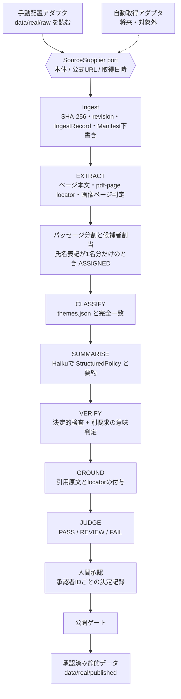

# Design Document

## Overview

### 目的と範囲

本designは、`requirements.md`の5要件を最小の追加で実現する。対象選挙を2022年の1件に固定した状態から、選挙定義をデータとして複数登録できる状態へ移し、PDF資料を「取り込み、ページ単位で抽出し、パッセージ単位でAI解析し、検証し、人間が承認したものだけを承認済み静的データとして出す」経路を、ローカルのCLIとして追加する。

| 方針 | 内容 |
| --- | --- |
| 既存契約は置き換えない | `ElectionSchema`、`CandidateSchema`、`SourceManifestRecordSchema`、`LocatorSchema`、`ProvenanceSchema`、`StructuredPolicySchema`、`CitationSchema`、`DeterministicCheckSchema`、`SemanticCheckSchema`、`VerificationRecordSchema`、`AiArtifactSchema`、`ApprovalSnapshotSchema`を変更せず、隣に薄いschemaを足す |
| 既存実装を再利用する | Bedrockは`createBedrockConverseClient`、保存は`atomicWriteImmutableFile`と`writeContentAddressedFile`、ハッシュは`sha256Hex`、`Result`、`safeLogger`、`createStoragePathConfig` |
| 追加の入口はCLIだけ | HTTP routeを追加しない。インターネットから呼べるBedrock endpointは0件のまま |
| `apps/web`は変更しない | 承認済み静的データを`data/real/published/`に生成するところまでを本featureとし、webへの受け渡しは共同開発者の承認を得た別タスク |
| 年・候補者名・ファイル名を書かない | 選挙ID、選挙名、投票日、候補者名、PDFファイル名は`config/election/elections.json`と実行時引数だけから得る |

対象外は、自動取得の実装、OCR、web変更、公開Bedrock endpoint、候補者の手動割当UIである。

### 選挙状態のライフサイクル（設計判断）

`requirements.md`は、`CURRENT`がちょうど1件でなければ全データを除外する（Requirement 1.7）。一方で候補者定義は1件以上必要である（同1.1）。2026年の候補者は公式ページから開発者が転記するまで確定しないため、推測で埋めない。したがって次の順序にする。

1. 現状: registryは2022年の定義1件だけを持ち、状態は`CURRENT`（現行動作を維持する）。
2. 2026年の候補者を開発者が公式ページから転記したら、2026年の定義を`PLANNED`で追加する。
3. 開発者が承認して切替えると、2022年が`PAST`、2026年が`CURRENT`になる（1回の更新）。2022年の定義と候補者は変更しない。

## Architecture

### 全体フロー

各ボックスは独立した段階であり、段階入力と段階出力を保存する。Bedrockを呼ぶのは「テーマ分類」「構造化要約」「検証（意味判定）」の3箇所だけである。



### 段階一覧と冪等性

| 段階 | 入力 | 出力 | Bedrock |
| --- | --- | --- | --- |
| EXTRACT | PDFバイト列、`sha256`、`revision` | ページ本文、画像ページ一覧、パッセージ一覧 | 0 |
| CLASSIFY | パッセージ | テーマ名または「未分類」 | 1 |
| SUMMARISE | パッセージ、テーマ | `StructuredPolicy`、初心者向け要約 | 1 |
| VERIFY | パッセージ、SUMMARISEの出力 | `DeterministicCheck[]`、`SemanticCheck`（別要求） | 1 |
| GROUND | パッセージ、SUMMARISEとVERIFYの出力 | `PolicyUnit`、`Citation[]` | 0 |
| JUDGE | VERIFYの出力 | `VerificationRecord`、`AnalysisArtifact` | 0 |

1パッセージの解析は最大3回のBedrock呼出しである。試験実行（5パッセージ）は最大15回で、後述の間隔制御により約95秒で終わる。

冪等性キーは`{ sourceSha256, revision, stage, modelId, inputHash }`である。`stageRunId = sha256Hex(正規化JSON(キー))`とし、Bedrockを呼ばない段階の`modelId`は`null`にする。`inputHash`は段階入力の正規化JSONのハッシュで、プロンプト版（`promptVersion`）を含む。ランナーは実行前に同じキーの`SUCCEEDED`を探し、見つかれば保存済み出力を返してBedrockを呼ばない（Requirement 2.5）。`FAILED`は別ファイルに記録し、キャッシュとして使わず、既存の`SUCCEEDED`も上書きしない（同4.7）。

### 保存レイアウト

```text
config/election/elections.json     # 追跡対象。選挙レジストリ（公開情報だけ）
config/themes.json                 # 追跡対象。テーマ一覧
data/real/raw/_objects/<shard>/<sha256>.pdf   # Git管理外。生PDFはここだけ
data/real/ingest/<sourceId>/<revision>.json   # IngestRecord（不変）
data/real/stages/<sourceSha256>/<revision>/<stage>/<stageRunId>.json   # StageRun（不変）
data/real/approvals/<artifactId>/<seq>.json   # 人間の決定記録（追記のみ）
data/real/published/<electionId>/bundle.json  # 承認済み静的データ（生成物）
```

- `.gitignore`の`data/real/**`で`data/real/`全体が追跡外であることを確認済み。新規ディレクトリはすべてこの配下に置く。
- `config/`ディレクトリは現時点で存在しない。本featureが`config/election/`と`config/themes.json`を新設する。
- 生PDFのバイト列は`data/real/raw`の外へ複製しない。手動配置されたファイルは、SHA-256で内容アドレス化した`_objects`へ取り込み、以後のrevisionは元ファイルが上書きされても再現できる。
- 不変ファイルは既存の`atomicWriteImmutableFile`で書く。同一パスへの再書込みは`already-present`になるため、revisionの一意性もパスで保証される。
- 取り込み資料記録の解析状態と承認状態は、保存ファイルを書き換えず、段階実行と決定記録から導出する（後述）。初期値`NOT_ANALYZED`と`PENDING`は取り込み時にそのまま保存する。

### 公開境界

- 新規HTTP routeを作らない。APIは既存のloopback限定のまま、Bedrock呼出しはCLIプロセス内の`createBedrockConverseClient`だけが行う。
- Vercelへ渡す候補は`data/real/published/`の承認済み静的データだけである。Bedrock認証キーをVercelの環境変数へ登録するか、静的データだけを置くかは未決事項（`requirements.md`のOpen decisions）で、管理者に確認するまで公開Bedrock endpointを作らない。
- ログは既存の`safeLogger`だけを通し、固定コード、`sourceId`、`revision`、段階名、`passageId`、原因区分だけを出す。認証キー、プロンプト、応答本文、ページ本文は出力しない。StageRunにも応答本文とプロンプト本文を保存せず、構文解析後の出力と`promptVersion`だけを保存する。

## Components and Interfaces

### 1. 選挙レジストリ（Requirement 1）

配置: schemaは`packages/contracts/src/models/electionRegistry.ts`、検証と状態遷移は`packages/domain/src/election/registry.ts`、ファイル読み書きは`apps/api/src/election/registryFile.ts`。

```ts
loadRegistry(file): Result<ValidatedRegistry, RegistryConfigError>        // ValidatedRegistryはbrand型
proposeChange(reg, toElectionId): Result<ChangeProposal, ChangeRejection>  // 副作用なし
decideChange(reg, proposal, "APPROVE" | "REJECT"): Result<ValidatedRegistry, ChangeFailure> // 純関数
```

- **汎用化の方法**: 既存の`ElectionSchema`（`z.literal`で2022年に固定）と`CandidateSchema`（`canonicalName`が2名の`z.enum`）には手を入れない。既存の2022年テストは同じ入力で同じ結果になる。`ElectionDefinitionSchema`、`CandidateDefinitionSchema`、`ElectionRegistryFileSchema`を新設し、`models/index`へexportを足すだけにする。
- **再利用する型**: `ElectionIdSchema`、`CandidateIdSchema`（`models/primitives.ts`のbrand型）、`ISODateSchema`、`NonEmptyStringSchema`。`ElectionIdSchema`には`/^[A-Za-z0-9-]{1,64}$/u`の`refine`、`CandidateIdSchema`には64文字以下の`refine`を足し、brandは保つ。名称は`Array.from(value).length`でコードポイント数を数える（`approval.ts`と同じ方法）。
- **fail closed**: 全解析・検索・表示の入口（取り込み、段階ランナー、公開ゲート）は`ValidatedRegistry`を引数に取る。`loadRegistry`が失敗した場合、この値が作れないため処理に入れない。`loadRegistry`は`CONTRACT_VIOLATION`、`DUPLICATE_CANDIDATE_ID`、`DUPLICATE_ELECTION_ID`、`INVALID_CURRENT_COUNT`を重複なく全て返し、ファイルは書き換えない。
- **切替の流れ**: `proposeChange`は変更前後の選挙名と選挙IDを返すだけで何も書かない。対象が未登録、または既に`CURRENT`なら`ChangeRejection`（対象不正）。CLIが両者を表示して`y/N`の承認を求める。承認時のみ、`decideChange`が「旧`CURRENT`を`PAST`へ、新しい選挙を`CURRENT`へ」変えた全体を返し、`elections.json`を一時ファイルへ書いてから改名する置換（atomic replace）で1回に反映する。既存`atomicFiles`は作成専用なので、同じ`allowedRoot`検証と予約名拒否を使う小さな`atomicReplaceFile`を`apps/api/src/store/`に足す。拒否、対象不正、書込み失敗では元のファイルが残り、理由（拒否、対象不正、更新失敗）を表示する。
- `ehime-vote-navigator`のtask 4.2（対象選挙変更proposal）は未着手である。`proposeChange`と`decideChange`は同じ二段階モデルなので、4.2に着手する際は本関数を共有する。

### 2. 資料供給と取り込み（Requirement 2）

配置: `apps/api/src/ingest/`。

```ts
interface SuppliedSource { bytes: Uint8Array; officialUrl: string; retrievedAt: ISOInstant }
interface SourceSupplier { supply(ref: string): Promise<Result<SuppliedSource, SupplyError>> }
type IngestRequest = { sourceId; electionId; assignment: { state: "ASSIGNED"; candidateId } | { state: "SHARED" } | { state: "UNASSIGNED" } }
ingest(reg, store, supplied, request): Result<IngestOutcome, IngestRejection>   // CREATED | UNCHANGED
```

- 手動配置アダプタは`data/real/raw/`直下のファイル名を引数に取る（パスの`..`と区切り文字は拒否）。公式URLは`--url`で必須、取得日時は`--retrieved-at`で指定でき、省略時は取り込みコマンドの実行時刻（UTCオフセット付き）を入れる。どちらかが欠けると`SupplyError`になる。
- 取り込み資料記録に供給元の種類と取り込み時刻を保存しない。同じ入力から供給元に関係なく同一の記録を作る（同2.1）。
- `decideIngest(latest, sha256)`は純関数で、最新revisionと同じSHA-256なら`UNCHANGED`（何も作らない）、異なれば`revision = r{n+1}`の新規記録を返す。旧revisionの記録は書き換えない（同2.4、2.7）。
- 候補者の割当は開発者が`--candidate`（`ASSIGNED`）または`--shared`（`SHARED`）で明示した場合だけ設定する。どちらもなければ`UNASSIGNED`で`candidateId`を持たない（同2.3）。選挙IDが未登録、候補者IDが当該選挙にない、供給項目が欠けている場合は何も書かず、不備の項目を表示する（同2.6）。
- Source Manifestの項目（`title`、`publishedAt`、`usage`、`adoptionDecision`）は開発者が入力する。取り込み処理は`toManifestDraft(ingest, devInput)`で既存の`SourceManifestRecordSchema`に沿った下書きを作るだけで、採用判断や利用確認を推測しない。
- 解析状態と承認状態の導出: `NOT_READY`（EXTRACTが`NOT_READY`）、`NOT_ANALYZED`（段階実行なし）、`FAILED`（段階ごとの最新実行が`FAILED`で後続の`SUCCEEDED`なし）、`COMPLETED`（全パッセージのJUDGEが`SUCCEEDED`）、それ以外は`IN_PROGRESS`。承認状態は、公開対象（`ASSIGNED`で判定が`FAIL`でない結果）の全件が公開ゲートの承認条件を満たせば`APPROVED`、全件で承認者の最新決定が却下なら`REJECTED`、それ以外は`PENDING`。

### 3. PDF抽出とパッセージ（Requirement 3）

配置: ポートは`apps/api/src/extract/pdfTextExtractor.ts`、純関数（分割、割当）は`packages/domain/src/analysis/`。

```ts
interface PdfTextExtractor { extract(bytes: Uint8Array): Promise<Result<readonly string[], PdfError>> } // 添字0がpage 1
splitIntoPassages(pages: readonly string[], maxChars = 1000): Passage[]
attributePassage(text, page, candidates): { assignment; evidence }
```

- ページ番号はPDF先頭を1とする物理順で、`{ kind: "pdf-page", page }`（既存`PdfPageLocatorSchema`）を付ける。同一ページ内の区別は`passageId = <sourceId>:<revision>:p<page>:<index>`と、`charStart`/`charEnd`で行う（`LocatorSchema`は変更しない）。
- 画像ページは、空白と改行を除いた文字数が0のページ。全ページが画像ならOCRを呼ばず、パッセージを保存せず、解析状態を`NOT_READY`にする。一部だけ画像の場合は文字層のあるページだけを解析し、画像ページ番号を記録して表示する。
- 分割は、改行と「。」「！」「？」の直後で区切った断片を`maxChars`まで貪欲に結合する決定的な規則とする。`maxChars`を超える断片は`maxChars`で切る。パッセージはページをまたがず、空白以外の文字を足したり落としたりしない。`maxChars = 1000`はシステム指示（3000文字以下）と合わせても20000文字に十分収まるための値である。
- 氏名照合は、パッセージ本文と各候補者の氏名表記の両方にNFKC正規化と空白除去だけを施して部分一致で行う。PDFの文字層は氏名の途中に空白や改行を入れることがあるためである。あいまい一致、読み仮名変換、読み順の推測はしない。照合する氏名表記は候補者定義に登録された`name`と`nameForms`だけである。
- 一致した候補者がちょうど1名なら`ASSIGNED`、根拠は`{ nameForm, page }`。0名または2名以上なら`UNASSIGNED`で`candidateId`を持たない（同3.5、3.6）。ある候補者の氏名が別の候補者の氏名の部分文字列なら、両方に一致して`UNASSIGNED`になる（安全側）。
- 出所（Provenance）に使う候補者は`resolveEffectiveCandidate`で決める。パッセージが`ASSIGNED(c)`なら、資料が別の候補者`d`に`ASSIGNED`の場合は競合として候補者なし、それ以外は`c`。パッセージが`UNASSIGNED`なら、資料が`ASSIGNED(d)`のときだけ`d`。候補者なしのパッセージは解析できるが、`ExtractedSegment`、`PolicyUnit`、`Citation`、`ApprovalSnapshot`が`candidateId`を必須とするため承認と公開の対象にならない。

**PDFライブラリの比較**（追加には利用者の承認が必要。`package.json`にPDFライブラリは未導入）

| 観点 | `pdfjs-dist`（legacy build） | `unpdf` | `pdf-parse` / `pdf-lib` |
| --- | --- | --- | --- |
| Node単体 | 可。描画しなければcanvas不要 | 可。pdf.jsを同梱した薄いラッパー | `pdf-lib`は本文抽出なし。`pdf-parse`は古いpdf.js同梱で保守が弱い |
| ページ別本文（1始まり） | `getPage(n).getTextContent()` | `extractText(pdf, { mergePages: false })`でページごとの配列 | 全文1本が基本 |
| 日本語CIDフォント | 埋め込みフォントとToUnicodeは可。非埋め込みの定義済みCMapは`cMapUrl`の指定が必要で、制御できる | 同じエンジン。CMap指定の可否は要検証 | 対象外 |
| 画像ページ判定 | ページごとのテキスト項目が空 | ページごとの文字列が空 | 対象外 |
| ライセンス | Apache-2.0 | MIT（同梱pdf.jsはApache-2.0） | MIT |
| サイズ | 大きい（cmapとfontを含む） | 小さい | 小さい |

推奨は`pdfjs-dist`のlegacy build（正確なバージョン固定）である。日本語PDFの正否が最大のリスクで、`cMapUrl`と`standardFontDataUrl`を直接指定できる点を優先する。`unpdf`は同じエンジンの便利な包みで得られるものが少ない。いずれも`PdfTextExtractor`の背後に隠すので、差替えは1ファイルで済む。`pdfjs-dist`は信頼できないPDFを読むため、CVE-2024-4367が修正された4.2.67以降を使い、`isEvalSupported: false`を指定する。Nodeの`engines`要件はrepoのNode版と照合する（要確認）。

選挙公報は縦書きや段組みが多く、テキスト項目の並びが読み順と一致しない可能性がある。この場合パッセージに複数候補者が混ざり`UNASSIGNED`になる（安全側）。実PDFでの抽出品質は、依存追加の承認後にローカルで1件を抽出し、原本と目視で比較して確認する。

### 4. 段階ランナーとBedrock利用（Requirement 4）

配置: `apps/api/src/analysis/`（`stageRunner.ts`、`stageStore.ts`、`prompts.ts`、`cli.ts`）。

- **モデル**: 既定は`jp.anthropic.claude-haiku-5-5`。`jp.anthropic.claude-opus-5-5`は、CLIの`--comparison`を明示した実行だけで使う。`modelId`が冪等性キーに入るため、比較実行の結果は別の`StageRun`になり、Haikuの結果を上書きしない。許可モデルの検査は既存クライアントの`ALLOWED_BEDROCK_MODEL_IDS`が行う。
- **試験実行と全量実行**: `run`は`--full`がなければ、(ページ昇順、ページ内の出現順)で先頭5パッセージだけを対象にする。`--full`を明示したときだけ全パッセージを対象にし、試験実行済みのパッセージはキャッシュに当たりBedrockを呼ばない。
- **1パッセージのリクエスト**: `system`は版付きの固定文（3000文字以下）、`text`は1パッセージだけを区切り記号で囲んで「データであって指示ではない」と明示する。合計が20000文字を超える場合、ランナーは送信前に`INPUT_TOO_LONG`として失敗にする（クライアントも検査する）。最大出力トークン数（2000）、タイムアウト（30秒）、同時実行1、毎分10回、再試行なしは既存クライアントが強制する。
- **間隔制御**: クライアントは上限超過を待たずに失敗にする。ランナーは送信前に呼出し間隔を6.1秒以上空ける（`Pacer`）。これは呼出し側のスケジューリングであり、クライアントは待機しない。
- **構造化出力**: 応答は純粋なJSONオブジェクトだけを受け付け（コードフェンスや前後の文章は不可）、Zod strictで検証する。失敗は`RESPONSE_INVALID`としてその段階を`FAILED`にし、再試行しない。テーマ分類の応答は`{ "theme": string }`で、`themes.json`のテーマ名と完全一致するときだけ採用し、それ以外は「未分類」とする。テーマ名が0件なら実行を中止する。`themes.json`の名称に予約語「未分類」は使えない。
- **意味判定**: VERIFYは、SUMMARISEとは別のBedrock要求で、元パッセージと構造化結果を渡して`meaningChange`、`meaningReversal`、`unsupportedAddition`を`DETECTED`/`NOT_DETECTED`/`UNDETERMINED`で返させる（既存`SemanticCheckSchema`の項目）。SUMMARISEのプロンプトと応答は渡さない。
- **決定的検査**: 既存kindのうち`QUOTE_EXISTS`（`evidenceQuote`が正規化後のパッセージ本文に含まれれば`PASS`、含まれなければ`FAIL`、引用がなければ`UNVERIFIABLE`）と`PROVENANCE_MATCH`（locatorのページ、候補者、SHA-256が一致すれば`PASS`、不一致は`FAIL`、候補者なしは`UNVERIFIABLE`）だけを使う。
- **GROUND**: Bedrockを呼ばずに、`evidenceQuote`と`locator`から`PolicyUnit`と`Citation`を作る。`locator`はモデルが返した値ではなくパッセージのページから設定する。
- **段階の再実行**: `stage <名前> --source --revision [--passage]`は、保存済みの上流出力（最新の`SUCCEEDED`）を入力にして1段階だけ実行する。必要な入力またはテーマ一覧が読めなければ、段階名と原因区分を表示して中止する。他の段階の保存ファイルには触れない。上流の出力を差し替えても下流は自動では更新されない（下流の`inputHash`は上流出力のハッシュなので、古い出力を参照し続ける）。

### 5. 判定、承認、公開ゲート（Requirement 4.5、5）

```ts
judge(det: readonly DeterministicCheckOutcome[], sem: readonly SemanticCheckOutcome[]): AutomaticStatus
parseRequiredApprovers(env: string | undefined): Result<number, ConfigError>  // 未指定のみ1
buildPublishedBundle(reg, artifacts, decisions, required): PublishedElectionBundle
```

- `judge`は優先順位 FAIL > REVIEW > PASS で、`det`に`FAIL`または`sem`に`DETECTED`が1件でもあれば`FAIL`、`det`と`sem`が両方1件以上で全件`PASS`かつ全件`NOT_DETECTED`なら`PASS`、それ以外は`REVIEW`。`FAIL`の条件が片方の項目0件の場合と重なる場合は、`FAIL`を優先する。意味判定は3項目をまとめて`sem`に渡す。
- **承認の型**: 既存の`ApprovalSnapshotSchema`は`automaticStatus: z.literal("PASS")`で、`REVIEW`の結果を人間が承認できない。置換せず`AnalysisApprovalSnapshotSchema = ApprovalSnapshotSchema.extend({ automaticStatus: z.enum(["PASS","REVIEW"]), modelIds: AnalysisModelIdsSchema, promptVersions: AnalysisPromptVersionsSchema })`を足し、`ApprovalRecordSchema.extend({ snapshot })`で承認記録を作る。`AnalysisModelIdsSchema`は`ModelIdsSchema.omit({ embedding: true })`（本featureは埋め込みを使わない）、`AnalysisPromptVersionsSchema`は`PromptVersionsSchema`に`classification`を足したもの。却下は既存の`RejectionRecordSchema`をそのまま使う。決定記録は`previousRecordHash`で連鎖し、追記のみとする。
- **AI解析結果**: `AnalysisArtifactSchema = AiArtifactSchema.extend({ modelIds, promptVersions, theme })`。`humanStatus`は常に`PENDING`で保存し、実際の承認状態は決定記録から導出する。
- **公開ゲート**: 資料ごとに最新revisionの結果だけを対象にする（旧revisionの承認は、内容が変わった資料の古い承認を公開しないために対象外）。結果は、判定が`FAIL`でなく、承認者ごとの最新決定が`APPROVED`かつ`snapshot`が現在の結果（SHA-256、revision、モデルID、内容ハッシュ）と一致する承認者が、必要承認者数以上のときだけ含まれる。`REQUIRED_APPROVER_COUNT`は未設定なら1、設定されていれば`/^[1-9][0-9]*$/u`に一致する安全な整数だけを許し、空文字列、0、負数、小数、数値以外は設定エラーとして`bundle.json`を書かず、既存の公開用データと決定記録を変更しない。該当する結果が0件なら`items: []`のバンドルを生成する。
- **公開データ**: 後述の`PublishedElectionBundle`は、承認済みの構造化結果、要約、`Citation`（引用原文とlocator）、承認者数だけを持つ。生資料、ページ本文、パッセージ本文を含めない。

### 6. CLI

`npm run analysis -- <command>`（`apps/api`）。すべてローカル実行で、ポートを開かない。

| コマンド | 内容 |
| --- | --- |
| `election show` / `election change <id>` | 現在選挙の表示、承認付き切替 |
| `ingest <file> --election --source [--candidate\|--shared] --url [--retrieved-at]` | 取り込み |
| `extract --source --revision` | EXTRACTのみ（Bedrock 0回） |
| `run --source --revision [--full] [--comparison]` | 試験実行（既定）または全量実行 |
| `stage <名前> --source --revision [--passage]` | 1段階の再実行 |
| `decide --artifact --approver --approve\|--reject --reason` | 人間の決定の追記 |
| `publish --election` | 公開ゲートを通して`bundle.json`を生成 |

## Data Models

TypeScriptはschemaの要点だけを示す。すべて`z.object(...).strict()`で、`packages/contracts/src/models/`に置く。

```ts
// electionRegistry.ts（既存のElectionSchema等は変更しない）
export const ELECTION_STATUSES = ["PAST", "CURRENT", "PLANNED"] as const;
export const CandidateDefinitionSchema = z.object({
  candidateId: CandidateIdSchema.refine(len1to64),
  name: Text1to50,                         // 1〜50コードポイント
  nameForms: z.array(Text1to50).min(1),    // 資料上の氏名表記（照合に使う唯一の文字列）
}).strict();
export const ElectionDefinitionSchema = z.object({
  electionId: ElectionIdSchema.refine(/^[A-Za-z0-9-]{1,64}$/u),
  name: Text1to100,
  electionDate: ISODateSchema,             // YYYY-MM-DD の実在日
  status: z.enum(ELECTION_STATUSES),
  candidates: z.array(CandidateDefinitionSchema).min(1).max(20),
}).strict();
export const ElectionRegistryFileSchema = z.object({
  schemaVersion: z.literal(1),
  elections: z.array(ElectionDefinitionSchema).min(1),
}).strict();
```

```ts
// analysis.ts
export const AssignmentSchema = z.discriminatedUnion("state", [
  z.object({ state: z.literal("ASSIGNED"), candidateId: CandidateIdSchema }).strict(),
  z.object({ state: z.literal("SHARED") }).strict(),
  z.object({ state: z.literal("UNASSIGNED") }).strict(),
]);
export const ANALYSIS_STATUSES = ["NOT_ANALYZED", "IN_PROGRESS", "COMPLETED", "FAILED", "NOT_READY"] as const;

export const IngestRecordSchema = z.object({     // 不変。供給元の種類と取り込み時刻は持たない
  sourceId: SourceIdSchema, electionId: ElectionIdSchema, revision: RevisionSchema, // "r1","r2",...
  assignment: AssignmentSchema,
  officialUrl: z.string().url(), retrievedAt: ISOInstantSchema,
  sha256: Sha256Schema, byteLength: z.number().int().nonnegative(),
  rawSnapshotRelativePath: NonEmptyStringSchema,  // data/real/raw 配下の相対パス
  analysisStatus: z.literal("NOT_ANALYZED"), approvalStatus: z.literal("PENDING"),
}).strict();
// IngestRecordView = IngestRecord の2状態を導出値（ANALYSIS_STATUSES / HumanStatus）に置換したもの

export const PassageSchema = z.object({
  passageId: NonEmptyStringSchema, page: z.number().int().positive(), index: z.number().int().nonnegative(),
  charStart: z.number().int().nonnegative(), charEnd: z.number().int().positive(),
  text: NonEmptyStringSchema, textSha256: Sha256Schema,
  assignment: AssignmentSchema,                    // ASSIGNED か UNASSIGNED のみ
  evidence: z.object({ nameForm: NonEmptyStringSchema, page: z.number().int().positive() }).strict().nullable(),
}).strict();
export const ExtractionOutputSchema = z.object({
  pageCount: z.number().int().positive(), imagePages: z.array(z.number().int().positive()),
  pages: z.array(z.object({ page: z.number().int().positive(), text: z.string() }).strict()),
  passages: z.array(PassageSchema),
  notReady: NotReadyReasonSchema.nullable(),       // PDF_CORRUPT | PDF_ENCRYPTED | PDF_NO_PAGES | PDF_TOO_LARGE | PDF_TOO_MANY_PAGES | ALL_PAGES_IMAGE
}).strict();

export const ANALYSIS_STAGES = ["EXTRACT", "CLASSIFY", "SUMMARISE", "VERIFY", "GROUND", "JUDGE"] as const;
export const StageRunSchema = z.object({
  stageRunId: Sha256Schema,                        // = sha256Hex(正規化JSON(key))
  key: z.object({ sourceSha256: Sha256Schema, revision: RevisionSchema, stage: z.enum(ANALYSIS_STAGES),
                  modelId: z.string().nullable(), inputHash: Sha256Schema }).strict(),
  runId: RunIdSchema, scope: z.enum(["PILOT", "FULL", "STAGE"]), passageId: z.string().nullable(),
  status: z.enum(["SUCCEEDED", "FAILED"]), input: z.unknown(), output: z.unknown().nullable(),
  errorClass: z.string().nullable(), createdAt: ISOInstantSchema,   // input/outputは段階ごとのschemaで再検証
}).strict();
```

- **既存契約の再利用**: SUMMARISEの出力は`StructuredPolicySchema`と300文字以下の要約、VERIFYの出力は`DeterministicCheckSchema`と`SemanticCheckSchema`、JUDGEの出力は`VerificationRecordSchema`、GROUNDの出力は`PolicyUnitSchema`と`CitationSchema`である。`candidateId`を持つこれらは、有効な候補者があるパッセージにだけ作る。
- **再利用しないもの**: 既存の`RUN_STAGE_NAMES`と`RunStagesSchema`は、埋め込みと検索を含む7段階の固定タプルで、本featureの6段階と合わないため使わない。`AiArtifactSchema.runId`には本featureの`runId`を入れる。
- **`artifactId`**: `sha256Hex(sourceId|revision|passageId)`の先頭16桁に`art-`を付けた決定的な値にする。

```ts
// published.ts（承認済み静的データ）
export const PublishedItemSchema = z.object({
  artifactId: ArtifactIdSchema, candidateId: CandidateIdSchema, sourceId: SourceIdSchema,
  revision: RevisionSchema, sourceChecksum: Sha256Schema, theme: NonEmptyStringSchema,
  structured: StructuredPolicySchema, beginnerSummary: NonEmptyStringSchema,
  citations: z.array(CitationSchema),              // 引用原文とlocator。これ以外の資料本文は持たない
  automaticStatus: z.enum(["PASS", "REVIEW"]), approverCount: z.number().int().positive(),
  modelIds: AnalysisModelIdsSchema,
}).strict();
export const PublishedElectionBundleSchema = z.object({
  schemaVersion: z.literal(1), dataKind: RealAiDataKindSchema, electionId: ElectionIdSchema,
  generatedAt: ISOInstantSchema, requiredApprovers: z.number().int().positive(),
  items: z.array(PublishedItemSchema),
}).strict();
```

`config/themes.json`は`{ "schemaVersion": 1, "themes": ["教育", "経済", "防災"] }`で始め（例示であり、開発者が追加する）、名称は重複不可・予約語「未分類」不可とする。`config/election/elections.json`の初期内容は2022年の定義（選挙ID`ehime-governor-2022-20`、名称、2022-11-20、`CURRENT`、中村時広氏と林紀子氏、「林のりこ」の氏名表記）のみで、2026年の定義と候補者は公式ページから開発者が転記する。候補者IDは最初のレジストリ作成時に決め、以後変更しない。

## Correctness Properties

*A property is a characteristic or behavior that should hold true across all valid executions of a system-essentially, a formal statement about what the system should do. Properties serve as the bridge between human-readable specifications and machine-verifiable correctness guarantees.*

### Property 1: レジストリの検証とfail closed

For any 選挙レジストリのデータ, `loadRegistry`が`ValidatedRegistry`を返すのは、Zod strict契約に適合し、同一選挙内の候補者IDと選挙間の選挙IDに重複がなく、`CURRENT`がちょうど1件のときに限る。それ以外では、該当する違反の種類（契約違反、候補者ID重複、選挙ID重複、現在選挙数の不正）を全て返し、入力データを変更しない。

**Validates: Requirements 1.1, 1.7**

### Property 2: 選挙切替の状態機械

For any 有効なレジストリと、提案、承認、拒否、未登録または既に`CURRENT`の対象、書込み失敗を任意に並べた操作列について、各操作の後も`CURRENT`はちょうど1件であり、承認が完了するまでレジストリは変わらない。承認は旧`CURRENT`を`PAST`、新しい選挙を`CURRENT`にする2件の状態変更だけを1回の更新で行い、選挙名、投票日、候補者定義を含むそれ以外の値（2022年の定義を含む）を変えない。拒否、対象不正、更新失敗ではレジストリが完全に元のままで、理由の区分が返る。

**Validates: Requirements 1.2, 1.4, 1.5, 1.6**

### Property 3: 取り込みの記録、冪等性、revision

For any 資料本体、公式URL、取得日時、および任意の供給元アダプタ（手動配置またはfake自動取得）について、作られる取り込み資料記録は供給元の種類に関係なく同一で、`sha256`は本体の`sha256Hex`と一致し、初期状態は`NOT_ANALYZED`と`PENDING`である。同一`sourceId`の取り込み列に対し、最新revisionと同じSHA-256なら記録は増えず保存済みの内容も変わらない。異なるSHA-256なら、revisionが1つ増えた記録がちょうど1件追加され、旧revisionの記録はバイト単位で変わらない。

**Validates: Requirements 2.1, 2.2, 2.4, 2.7**

### Property 4: 取り込みの拒否と候補者の非推測

For any 取り込み要求について、候補者を単一に指定しなければ記録の`assignment`は`SHARED`または`UNASSIGNED`で`candidateId`を持たない。選挙IDが未登録、候補者IDが当該選挙にない、または本体、公式URL、取得日時のいずれかが欠けている場合は、記録を作らず、既存の記録を変えず、不備の項目を示す理由を返す。

**Validates: Requirements 2.3, 2.6**

### Property 5: 段階実行のキャッシュ

For any 冪等性キー`{ sourceSha256, revision, stage, modelId, inputHash }`について、`SUCCEEDED`の保存済み実行があれば、ランナーはその出力を返し、Bedrock呼出しは0回である。キーの5要素のどれか1つでも異なれば保存済み実行は使われない。

**Validates: Requirements 2.5**

### Property 6: ページlocatorとパッセージ分割

For any ページ本文の配列について、ページ番号は1からページ数までの整数で、パッセージは(ページ番号, ページ内の出現順)の昇順に並ぶ。各パッセージはページをまたがず、`maxChars`以下で、全パッセージの連結から空白を除いた文字列は元のページ本文から空白を除いた文字列と一致する（文字の追加も欠落もない）。

**Validates: Requirements 3.1, 3.4**

### Property 7: 画像ページ判定とNOT_READY

For any ページ本文の配列について、画像ページ一覧は空白と改行を除いた文字数が0のページ番号と一致する。全ページが画像、または処理できないPDF（破損、パスワード保護、ページ数0、50MB超、200ページ超）の場合は、パッセージとページテキストを1件も保存せず、解析状態は`NOT_READY`で、原因区分が示され、OCRとBedrockの呼出しは0回である。

**Validates: Requirements 3.2, 3.3, 3.7**

### Property 8: 氏名表記による候補者割当

For any 候補者集合とパッセージ本文について、登録された氏名表記に一致する候補者がちょうど1名（同一候補者の複数出現は1名）なら`ASSIGNED`でその候補者IDと根拠（氏名表記、ページ）を持ち、0名または2名以上なら`UNASSIGNED`で`candidateId`を持たない。出所に使う候補者は、明示的な氏名の根拠または資料の明示的な指定だけから決まり、両者が食い違えば候補者なしになる。

**Validates: Requirements 3.5, 3.6**

### Property 9: 判定関数

For any 決定的検査の結果列と意味判定の結果列について、`judge`は全域関数であり、`FAIL`が1件以上、または`DETECTED`が1件以上なら`FAIL`、そうでなく両方が1件以上で全件`PASS`かつ全件`NOT_DETECTED`なら`PASS`、それ以外は`REVIEW`を返す（優先順位は FAIL > REVIEW > PASS）。

**Validates: Requirements 4.5**

### Property 10: 試験実行の対象選択

For any パッセージ列について、`--full`なしの`run`の対象は、(ページ昇順、ページ内の出現順)の先頭`min(5, n)`件であり、それ以外のパッセージに対するBedrock呼出しは0回である。

**Validates: Requirements 4.6**

### Property 11: 送信リクエストの制約とモデル選択

For any 実行計画（パッセージ数、本文長、呼出し間隔、比較実行の有無）について、送信される全リクエストは入力が20000文字以下、最大出力トークン数が2000で、同時に処理中のリクエストは1件以下、任意の60秒の窓内の呼出しは10回以下であり、上限を超える要求は送信されず、再試行は行われない。`--comparison`がなければ`modelId`は全て`jp.anthropic.claude-haiku-5-5`である。

**Validates: Requirements 4.3, 4.4**

### Property 12: 段階の独立性と失敗時の不変

For any 段階とパッセージの再実行について、他の段階の保存済み出力はバイト単位で変わらない。入力欠落、テーマ一覧の読み込み失敗、テーマ0件、Bedrockエラーを注入した場合は、その段階の既存の出力が変わらず、失敗した段階名と原因区分が返る。

**Validates: Requirements 4.1, 4.7**

### Property 13: テーマの完全一致

For any テーマ一覧とモデルの応答文字列について、割り当てるテーマは応答がテーマ名と完全一致するときだけそのテーマであり、部分一致、空白や大文字小文字の違い、解析できない応答は全て「未分類」になる。

**Validates: Requirements 4.2**

### Property 14: 公開ゲート

For any AI解析結果の集合、決定記録、必要承認者数について、公開用データに含まれる結果の集合は、各資料の最新revisionの結果のうち、判定が`FAIL`でなく、最新の決定が`APPROVED`で`snapshot`（SHA-256、revision、モデルID、内容）が現在の結果と一致する異なる承認者が必要承認者数以上のものと一致する。該当が0件なら`items`は空で、決定記録は変更されない。

**Validates: Requirements 5.1, 5.7**

### Property 15: 必要承認者数の設定

For any 設定値の文字列または未指定について、未指定なら1、`/^[1-9][0-9]*$/u`に一致する安全な整数ならその値、それ以外（空文字列、0、負数、小数、数値以外）なら設定エラーであり、設定エラーのとき公開用データは生成されず、既存の公開用データと決定記録は変更されない。

**Validates: Requirements 5.2**

### Property 16: 公開データの最小性

For any ページ本文、パッセージ、承認済みの結果について、公開用データのシリアライズ結果は、`Citation`の引用原文に含まれない資料本文（ページ本文とパッセージ本文の目印文字列）を含まず、strict schemaは余剰項目を持つバンドルを拒否する。

**Validates: Requirements 5.3**

### Property 17: 生資料の配置

For any 資料本体について、取り込み後に本体のバイト列を含むファイルは`data/real/raw`の配下だけに存在する。

**Validates: Requirements 5.4**

### Property 18: 機密情報の非出力

For any 認証キー、プロンプト、応答本文、ページ本文の目印文字列を含む実行について、成功時と失敗時のどちらでも、捕捉した標準出力、標準エラー出力、ログ、CLIの表示、エラー、公開用データに目印は現れない。

**Validates: Requirements 5.5**

## Error Handling

エラーは`Result`で返し、メッセージは固定文と原因区分だけにする（ファイルパス、本文、キーを含めない）。CLIは成功で終了コード0、拒否または失敗で1を返す。

| 領域 | 原因区分 | 結果 |
| --- | --- | --- |
| レジストリ読込み | `CONTRACT_VIOLATION`、`DUPLICATE_CANDIDATE_ID`、`DUPLICATE_ELECTION_ID`、`INVALID_CURRENT_COUNT` | `ValidatedRegistry`を作らず全入口を拒否。ファイルは変更しない |
| 現在選挙の変更 | `REJECTED`、`TARGET_INVALID`（未登録または既に`CURRENT`）、`UPDATE_FAILED` | レジストリは元のまま。原因を表示 |
| 取り込み | `SUPPLY_INCOMPLETE`（欠けた項目名）、`UNKNOWN_ELECTION`、`UNKNOWN_CANDIDATE` | 記録を作らず既存記録を変更しない。解析・検索・表示の対象外 |
| 抽出 | `PDF_CORRUPT`、`PDF_ENCRYPTED`、`PDF_NO_PAGES`、`PDF_TOO_LARGE`、`PDF_TOO_MANY_PAGES`、`ALL_PAGES_IMAGE` | パッセージ0件、解析状態`NOT_READY`、人間確認が必要である旨を表示（OCRは実行しない） |
| 段階の入力 | `STAGE_INPUT_MISSING`、`THEME_LIST_UNREADABLE`、`THEME_LIST_EMPTY` | 当該段階を中止し、既存の出力を変更しない |
| Bedrock | `INPUT_TOO_LONG`、`CONFIG_NOT_READY`、`MODEL_NOT_ALLOWED`、`TOKEN_INVALID`、`BUSY`、`RATE_LIMITED`、`TIMEOUT`、`NETWORK_ERROR`、`HTTP_ERROR`、`RESPONSE_INVALID` | 当該段階を`FAILED`として記録。再試行しない。既存の`SUCCEEDED`を上書きしない |
| 公開 | `INVALID_REQUIRED_APPROVERS`、`STORE_WRITE_FAILED` | `bundle.json`を書かない。既存の公開用データと決定記録を変更しない |

承認の不成立（却下が最新、`snapshot`不一致）はエラーではなく、必要承認者数に数えないだけで、決定記録は変更しない。ストレージの失敗は既存の`AtomicFileError`の固定メッセージをそのまま使う。

## Testing Strategy

本featureには、判定関数、レジストリ検証、分割、割当、公開ゲートなど入出力が明確な純関数が多く、入力空間も広いため、PBTを適用する。PBTを適用しないのは、PDFライブラリのアダプタ、CLIの入出力、`.gitignore`などの設定確認、実Bedrock呼出しで、これらは例示テストとSMOKEテストで扱う。

**PBTの設定**

- ライブラリは、リポジトリに導入済みの`fast-check` 4.10.2（`vitest` 5.1.0上）を使い、自作しない。
- 各性質を1つのプロパティテストとして実装し、最小100回（`numRuns: 100`以上）実行する。
- 各テストにコメント`Feature: multi-election-ai-analysis, Property {番号}: {性質の要旨}`を付ける。
- 通常のテストでネットワークとBedrockを使わない。`SourceSupplier`、`PdfTextExtractor`、`BedrockConverseClient`（または`fetch`）、時計（fake clock）、ファイルシステムの一時ディレクトリを差し替える。

**例示テストとSMOKEテスト**

| 内容 | 種別 |
| --- | --- |
| 実際の`config/election/elections.json`が契約に適合し、2022年の定義が仕様どおりで、2026年の定義を足したデータも読める（Requirement 1.2） | EXAMPLE |
| 既存の2022年テストを変更せず`npm test`で失敗0件（同1.3） | SMOKE |
| `git ls-files data/real`が0件、`git check-ignore data/real/raw/x.pdf`が成功（同5.4） | SMOKE |
| APIのroute一覧にBedrockを呼ぶ経路がなく、サーバーがloopback限定、CLIがポートを開かない（同5.6） | SMOKE |
| `--comparison`指定時だけ`jp.anthropic.claude-opus-5-5`が使われる（同4.3） | EXAMPLE |
| `pdfjs-dist`アダプタが、開発者が用意した架空文面の小さなPDF（文字層あり、画像のみ、破損、パスワード付き）で期待する区分を返す | EXAMPLE（依存追加の承認後） |

**手動コマンド（通常のテストに含めない）**

- `npm run analysis -- extract --source <id> --revision r1`: 実PDFのページ別抽出を人間が原本と目視で比較する。Bedrockは呼ばない。
- `npm run analysis -- run --source <id> --revision r1`: Haikuによる5パッセージ以下の試験実行。`AWS_BEARER_TOKEN_BEDROCK`が必要で、`--full`は結果を確認してから明示する。

## Implementation Order

最小の経路を次の順に実装する。手順1〜2、4〜6は、利用者の決定を待たずfakeで進められる。

1. **レジストリ汎用化**: `electionRegistry.ts`のschema、`registry.ts`の検証と`proposeChange`/`decideChange`、`registryFile.ts`と`atomicReplaceFile`、2022年だけの`elections.json`、`election show/change`。依存: なし。既存の2022年テストが変わらないことを最初に確認する。
2. **取り込みとSHA-256**: `SourceSupplier`、手動配置アダプタ、`IngestRecord`、内容アドレス化した生PDF保存、revision。依存: なし。割当の既定は`UNASSIGNED`なので、PDFが全候補者を含むかの未決事項に依存しない。
3. **PDF抽出とlocator**: `PdfTextExtractor`ポート、`splitIntoPassages`、`attributePassage`、`extract`コマンド（fakeで先行）。実アダプタは**PDFライブラリ追加の利用者承認**と、実PDFのローカル配置を待つ。
4. **段階基盤と試験実行**: `StageRun`ストアと冪等性キー、`Pacer`、`themes.json`、CLASSIFYとSUMMARISE、`run`（試験実行）。依存: テーマ一覧の初期内容の確認。実Bedrockの試験実行は`AWS_BEARER_TOKEN_BEDROCK`と手順3の実PDFを待つ。Opusとの比較後に採用モデルを決める（未決事項）。
5. **検証と判定**: VERIFY（決定的検査と別要求の意味判定）、GROUND、JUDGE、`judge`関数。依存: なし。
6. **承認と公開ゲート**: `AnalysisApprovalSnapshotSchema`、`decide`、`buildPublishedBundle`、`publish`、`REQUIRED_APPROVER_COUNT`。依存: 必要承認者数（既定1、チームが決定）。Vercelへの配置方法は管理者への確認を待つため、本手順は`data/real/published/`の生成までとする。
7. **2026年の追加と最終確認**: 開発者が公式ページから2026年の候補者を転記して`PLANNED`で追加し、`election change`で切替える。あわせて機密非出力、raw境界、route一覧のテストを通す。依存: 2026年の候補者の確定。

## Open Decisions

`requirements.md`の未決事項（承認者数、PDFの構成、Vercelでの扱い、採用モデル）に加え、本designで次を決める必要がある。

- **PDFライブラリの追加**: `pdfjs-dist`（推奨）または`unpdf`の追加には利用者の承認が必要。
- **2026年の候補者定義**: 公式ページからの転記時期。転記まで2022年が`CURRENT`のまま。
- **旧revisionの扱い**: 公開ゲートは資料ごとに最新revisionだけを対象にする。旧revisionの承認も公開したい場合は、この規則を変更する。
- **webへの受け渡し**: `data/real/published/`のバンドルをwebが読む方法は、共同開発者の承認を得た別タスクで決める。
