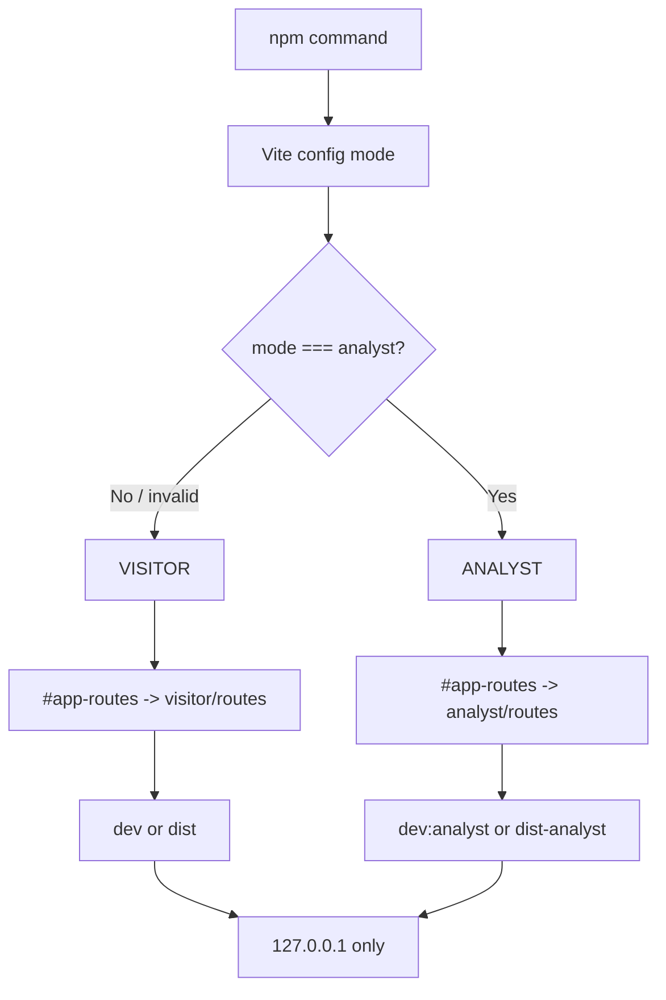
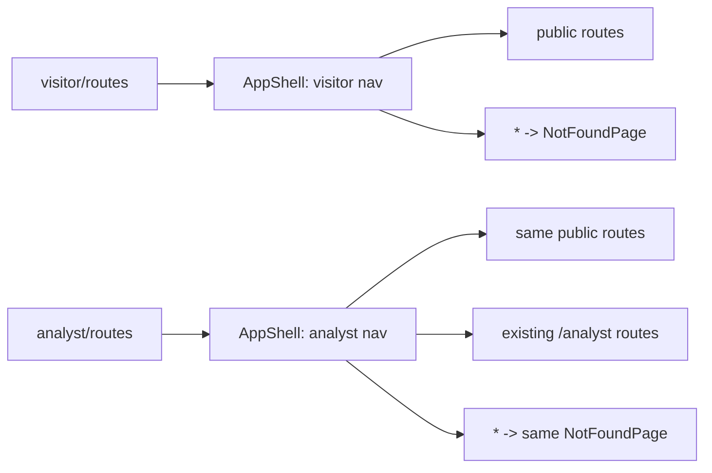

# Design Document

## Overview

### 目的

`visitor-analyst-mode-separation`は、現在1つのReact Router treeに同居している会場利用者向けrouteと分析者向けrouteを、build時に確定する2つのApplication Modeへ分ける。通常の`npm run dev`、`npm run build`、`npm run preview`はVisitor Modeを使用する。Analyst Modeは`dev:analyst`、`build:analyst`、`preview:analyst`の明示commandだけで使用する。

Visitor ModeではHomeとShared Navigationから分析者向けのlink、説明、用語を除去し、`/analyst/*`をrouterへ登録しない。直接URL entryを含むすべての`/analyst/*`は、既存AppShellを維持する404へ到達する。Analyst Modeでは既存の分析者routeとpage componentを保持する。mode選択は認証境界ではなく、ローカル会場表示と共同開発者UIを誤って混在させないbuild/startup境界である。

追加の限定差分として、公開側の独立した`/sources` routeを両modeのrouterから除外する。Visitor Homeとvisitor navigationから「出典一覧」linkを削除し、`/sources`の直接entryを両modeでShell-Preserving 404へ送る。参照がなくなった公開`SourcesPage` componentも削除する。ただし、候補者・政策・比較・AI生成情報に埋め込まれた出典、根拠引用、根拠link、locator、revision、checksum、source data、provenance contract、および内部`/analyst/sources`のSource Manifest管理は残す。APIとdomain layerは変更しない。

### 既存specとの整合

既存`.kiro/specs/ehime-vote-navigator/`は、P0の会場閲覧routeと分析route、AppShell、`NOT_READY`、loopback bind、P1/P2未登録を定義している。本specは既存route contractを削除せず、利用可能なmodeを次のように限定する。ただし、本follow-upは既存Requirement 19.1のうちHomeから独立した出典一覧へ移動する導線だけをsupersedeする。既存spec文書は編集せず、政策単位や画面内の出典・根拠要件はそのまま維持する。

| 既存contract | Visitor Mode | Analyst Mode |
|---|---|---|
| `/`、`/schedule`、`/candidates`、`/candidates/:candidateId`、`/comparison`、`/venue` | 登録 | 登録 |
| `/sources` | 未登録、wildcard 404 | 未登録、wildcard 404 |
| Existing Analyst Route（`/analyst/sources`を含む） | 未登録、wildcard 404 | 既存pathのまま登録 |
| P1/P2 route | 未登録 | 未登録 |
| AppShell、過去選挙、local-only、data kind | 維持 | 維持 |
| policy-level citation、evidence、provenance | 維持 | 維持 |
| `NOT_READY` | 維持 | 維持 |
| API Host/Origin/nonce境界とdomain/source data | 変更なし | 変更なし |

既存`ehime-vote-navigator`のrequirements、design、tasksは編集しない。完了済みTask 5.1の単一route skeletonに対するfollow-upを本specのtasksで管理する。`tasks.meta.json`はKiroの実行metadataであり、本featureの変更対象に含めない。

### 現在の実装

- `apps/web/src/app/routes.tsx`はpublic routeと全Existing Analyst Routeを1つの`Routes`へ常時登録し、公開`/sources`も常時登録している。
- `apps/web/src/app/pages.tsx`のHomeは、会場閲覧link、公開`/sources` link、および分析者linkを同時に表示し、同じmodule内に公開`SourcesPage`と`AnalystSourcesPage`がある。
- `apps/web/src/shared/ui/AppShell.tsx`のShared Navigationは`/sources`と`/analyst/readiness`を常時表示している。
- `apps/web/src/app/routes.test.tsx`は全routeが常時利用できる前提を検査している。
- `apps/web/vite.config.ts`は両serverを`127.0.0.1`へbindするが、Application Modeを持たない。
- rootには通常`build`があり、web workspaceには`dev`、`build`、`preview`がある。明示的なanalyst commandと分離出力はない。

### 設計方針

1. **既定値をfail closedにする**: literal `analyst`だけをAnalyst Modeへ写し、欠落、Vite既定の`development`/`production`/`test`、未知値、型不正をVisitor Modeへ写す。
2. **router登録自体を分ける**: Visitor Modeで分析者elementを登録してからredirectする方式を採用しない。Visitor Routerは分析者route descriptorを持たない。
3. **build compositionを分ける**: Vite configがmode別のroute entryをaliasし、Visitor Buildのmodule graphから分析者route/page moduleを外す。
4. **runtime昇格を作らない**: query string、hash、cookie、localStorage、sessionStorage、IndexedDB、browser toggle、API応答をmode決定に使用しない。
5. **成果物を分ける**: Visitor Buildは既存`dist`、Analyst Buildは`dist-analyst`へ出力する。通常previewは`dist`だけを配信する。
6. **安全境界を維持する**: loopback bind、`NOT_READY`、local-only banner、過去選挙banner、data kind、404、アクセシビリティを変更しない。
7. **認証に見せない**: Analyst Modeは同じ端末上の明示commandであり、authorizationではない。API認証やloginを追加しない。
8. **Standalone Sourcesだけを廃止する**: `/sources`を両route treeから外し、Home/navigationの公開linkと未参照`SourcesPage`を削除する。`/analyst/sources`、policy-level citation、evidence、provenance、source dataは変更しない。
9. **既存specを差分で上書きする**: `ehime-vote-navigator` Requirement 19.1の独立した出典一覧へのHome導線だけを本specの新しいroute matrixでsupersedeし、既存spec文書とTask Metadata Fileは編集しない。

Viteはcommand lineの`--mode`を受け取り、build時の定数を静的に置換できる。これをmode別entry選択に使う。previewは指定されたoutput directoryを配信するため、通常とanalystの出力先を分ける。[Vite CLI](https://vite.dev/guide/cli)および[Env Variables and Modes](https://vite.dev/guide/env-and-mode)を参照した。外部文書の内容は言い換えている。Content was rephrased for compliance with licensing restrictions.

## Architecture

### mode決定とbuild flow



`resolveApplicationMode(mode: unknown)`は純粋関数とする。`mode === "analyst"`だけが`ANALYST`で、それ以外は`VISITOR`である。Viteの`defineConfig(({ mode }) => ...)`はresolverの結果を使い、route module alias、build output、build markerを決める。

Application Modeを`import.meta.env`から任意に読むcomponentは作らない。router生成後にmodeを変更するstate、context setter、effect、event listenerも作らない。testはresolverと各route compositionを直接選択する。

### module構成

```text
apps/web/src/
  config/
    applicationMode.ts          # pure resolver and AppMode type
    virtual-app-routes.d.ts      # selected entry signature only
  app/
    public/
      pages.tsx                  # visitor-facing pages except retired SourcesPage, plus VisitorHome
      routeElements.tsx          # remaining shared public route declarations
    analyst/
      pages.tsx                  # analyst-only page components/content
      routes.tsx                 # public + analyst route tree
    visitor/
      routes.tsx                 # public + wildcard only
    navigation.tsx               # history-aware links, unchanged behavior
  shared/ui/AppShell.tsx         # receives explicit navigation variant/items
  App.tsx                        # imports only #app-routes selected by Vite
```

既存`pages.tsx`はpublic pageとanalyst pageを分ける。Visitor route entryから`app/analyst/*`へのimportを禁止する。Analyst route entryはpublic pageを再利用し、Existing Analyst Routeだけを追加する。`NotFoundPage`はpublic moduleへ置き、両modeが同じShell-Preserving 404を使う。公開`SourcesPage`はどちらのroute entryにもexport/importせず、参照がなくなった時点で削除する。`AnalystSourcesPage`はanalyst moduleへ移して`/analyst/sources`からだけ参照する。Embedded Source Evidenceをrenderする既存または将来のpage/component contractは公開`SourcesPage`から独立させる。

### Vite alias

概念上のconfigは次の形とする。

```ts
export default defineConfig(({ mode }) => {
  const applicationMode = resolveApplicationMode(mode);
  const analyst = applicationMode === "ANALYST";

  return {
    resolve: {
      alias: {
        "#app-routes": analyst
          ? absolutePath("src/app/analyst/routes.tsx")
          : absolutePath("src/app/visitor/routes.tsx"),
      },
    },
    build: {
      outDir: analyst ? "dist-analyst" : "dist",
    },
    server: { host: "127.0.0.1", port: 5173, strictPort: true },
    preview: { host: "127.0.0.1", port: 4173, strictPort: true },
  };
});
```

実装ではpathを`import.meta.url`から正規化し、OS依存の文字列連結を避ける。alias targetはresolver結果だけで決まり、query、storage、browser stateを参照しない。型宣言は`#app-routes`が`AppRoutes`をexportすることだけを定義し、modeを変更するAPIを公開しない。

### commandと成果物

| command | mode | web output / target | 備考 |
|---|---|---|---|
| `npm run dev` | VISITOR | development server | rootからweb workspaceの通常devへ委譲 |
| `npm run build` | VISITOR | `apps/web/dist` | 既存全workspace buildを維持 |
| `npm run preview` | VISITOR | `apps/web/dist` | 手動起動、loopback限定 |
| `npm run dev:analyst` | ANALYST | development server | `vite --mode analyst` |
| `npm run build:analyst` | ANALYST | `apps/web/dist-analyst` | API/shared package build後にanalyst webをbuild |
| `npm run preview:analyst` | ANALYST | `apps/web/dist-analyst` | 手動起動、loopback限定 |

web workspaceにも同名のmode別scriptを定義し、root scriptはworkspaceへ委譲する。`build:analyst`は通常`dist`をanalyst contentで上書きしない。`.gitignore`へ`**/dist-analyst/`を追加する。

各buildはmode markerをoutput内へ生成し、`VISITOR`または`ANALYST`とoutput targetを記録する。preview commandは対象directoryとmarkerを事前検査し、対象modeが一致しない、markerがない、directoryがない場合に終了する。別modeのdirectoryへfallbackしない。markerに秘密情報、AWS設定、原資料pathを含めない。

### route composition



Visitor Routerのroute childrenは次だけである。

- index `/`
- `/schedule`
- `/candidates`
- `/candidates/:candidateId`
- `/comparison`
- `/venue`
- `*`

Analyst Routerは上記にExisting Analyst Routeを追加する。`/sources`はどちらのrouterにも追加しない。`/sources`と`/analyst/*`専用catchを作らず、通常wildcardへ到達させる。これによりVisitor Modeの分析者path、両modeの`/sources`、および未知suffixは同じShell-Preserving 404になる。redirect、lazy fallback、別routeへの推測移動は行わない。

### Homeとnavigation

Public Homeの会場閲覧linkは、独立した`/sources` linkを除いて保持する。現在`PUBLIC_HOME_LINKS`にある「出典一覧を見る」と`/sources` destinationを削除する。現在`ANALYST_HOME_LINKS`として`pages.tsx`にある配列と説明はanalyst moduleへ移す。Visitor HomeのDOM、accessible tree、link href、text contentにはAnalyst Internal ContentもStandalone Public Sources linkも含めない。

`AppShell`はroute entryから確定済みnavigation variantまたはimmutable item配列を受け取る。Visitor navigationはホーム、日程、候補者、政策比較、会場閲覧だけを含む。Analyst navigationはこれらに明示的な「分析」導線を加えるが、公開`/sources` linkは含めない。内部Source Manifestへの入口は`/analyst/sources`としてAnalyst Homeまたは分析者navigation内に維持できる。mode切替button、select、linkはどちらにも置かない。

`aria-current`、history depth、戻る操作、skip link、header/main/footer landmarkは既存componentを再利用する。Homeへ戻ってもmodeはrouter entryに固定されているため変化しない。`/sources`へ直接entryした場合も同じAppShellとHome導線を持つ404をrenderする。

### local-onlyとsecurity boundary

Vite server/previewのhostは両modeで`127.0.0.1`に固定し、CLI scriptから`--host 0.0.0.0`を渡さない。Analyst Modeは認証ではないため、第三者へURLを配布できるsecurity controlとして説明しない。既存APIのloopback bind、Host allowlist、Origin allowlist、mutation nonce、1 MiB body制限は変更しない。

Visitor ModeでUI routeが消えても、APIのanalyst endpointを認証済みに変換したとは扱わない。本featureはweb compositionだけを対象とし、API endpoint削除やauthorization追加を行わない。READMEは「同じ端末の共同開発者用起動modeであり、一般公開用の権限制御ではない」と明記する。

### fail-closed error flow

- 不明mode: Visitor Modeへ正規化し、warningだけをbuild logへ出せる。browserへraw環境値を表示しない。
- Visitor Modeの`/analyst/*`: wildcard 404へ到達し、分析者pageをrenderしない。
- Visitor/Analyst build marker不一致: preview preflightを終了し、別outputを探さない。
- build output欠落: 対象directory名と再build commandを示して終了し、別modeへfallbackしない。
- route module解決不能: buildを失敗させ、runtimeで別modeへfallbackしない。

## Components and Interfaces

### Application Mode

```ts
export type ApplicationMode = "VISITOR" | "ANALYST";

export function resolveApplicationMode(mode: unknown): ApplicationMode {
  return mode === "analyst" ? "ANALYST" : "VISITOR";
}

export type BuildTarget = Readonly<{
  applicationMode: ApplicationMode;
  outputDirectory: "dist" | "dist-analyst";
  routeEntry: "visitor" | "analyst";
}>;
```

`resolveBuildTarget`は`resolveApplicationMode`の結果から1つのtargetを返す。任意の未知入力はvisitor targetへ収束する。`ApplicationMode`を変更するsetterやbrowser APIは定義しない。

### route contract

```ts
type AppRouteContract = Readonly<{
  path: string;
  heading: string;
  audience: "VISITOR" | "ANALYST";
}>;

const PUBLIC_ROUTE_CONTRACTS: readonly AppRouteContract[] = [/* existing paths */];
const ANALYST_ROUTE_CONTRACTS: readonly AppRouteContract[] = [/* existing analyst paths */];
```

contractはtest parameterizationとroute compositionの正本を共有できる。ただしpage elementそのものをdataへ押し込んで循環importを作らない。path、expected h1、audienceを持つread-only metadataとする。`PUBLIC_ROUTE_CONTRACTS`は`/sources`を含めず、`ANALYST_ROUTE_CONTRACTS`は`/analyst/sources`を含む。

`selectRouteContracts(mode)`はVisitor Modeで残存publicだけ、Analyst Modeで残存publicとanalystを返す。wildcardは両treeへ常時追加する。`selectRouteContract(mode, "/sources")`は両modeでwildcard contractを返す。

### AppShell

```ts
type NavigationVariant = "VISITOR" | "ANALYST";

type AppShellProps = Readonly<{
  dataKind?: "REAL_AI" | "FIXTURE";
  navigationVariant: NavigationVariant;
}>;
```

`navigationVariant`はselected route entryがliteralで渡す。URLやstorageから導出しない。Visitor variantはanalyst hrefとlabelを0件にする。Analyst variantは既存分析状態への入口を表示する。全bannerとfooterの`NOT_READY`表示は共通である。

### Build marker

```ts
type WebBuildMarker = Readonly<{
  schemaVersion: 1;
  applicationMode: ApplicationMode;
  outputDirectory: "dist" | "dist-analyst";
}>;
```

preview preflightは対象directory内の固定markerだけをstrict decodeする。markerに未知field、mode不一致、directory不一致があれば終了する。markerはruntime mode sourceではなく、既に生成された成果物とpreview commandの一致検査だけに使う。

## Data Models

本featureは選挙、候補者、資料、source data、provenance、citation、run、承認のdomain modelを変更しない。追加するdata modelはbuild/startup compositionを表す次の3つだけである。Standalone Public Sourcesの廃止はroute、navigation、Home projection、および公開page moduleの削除に限定し、Source Manifest recordやEmbedded Source Evidenceのschemaを変更しない。

```ts
type ApplicationMode = "VISITOR" | "ANALYST";

type BuildTarget = Readonly<{
  applicationMode: ApplicationMode;
  outputDirectory: "dist" | "dist-analyst";
  routeEntry: "visitor" | "analyst";
}>;

type WebBuildMarker = Readonly<{
  schemaVersion: 1;
  applicationMode: ApplicationMode;
  outputDirectory: BuildTarget["outputDirectory"];
}>;
```

`BuildTarget`はpure resolverの返却値であり、browserへ保存しない。`WebBuildMarker`はbuild成果物の検査用で、route treeを実行中に切り替える入力として使用しない。既存の`DataKind`、`ReadinessStatus`、candidate ID、run ID、artifact ID、API envelopeは変更しない。

## Correctness Properties

*A property is a characteristic or behavior that should hold true across all valid executions of a system, expressed as a universal statement that can be checked across generated inputs.*

### Property 1: fail-closed mode resolution

For any mode input, Mode Resolver SHALL return `ANALYST` only when the input is the exact allowed analyst token, SHALL return `VISITOR` for every other input, and SHALL remain unchanged when query strings, URL hashes, cookies, browser storage values, UI events, or API responses vary.

**Validates: Requirements 1.1, 1.4, 1.6, 1.7**

### Property 2: Visitor presentation omits analyst and retired standalone-source content

For any Visitor Mode rendering of Visitor Home or Shared Navigation, the rendered links, accessible names, and text content SHALL contain zero Existing Analyst Route destinations, zero Analyst Internal Content, and zero `/sources` destinations while retaining every configured remaining visitor destination.

**Validates: Requirements 2.1, 2.2, 2.3, 2.4, 2.5, 8.1, 8.2**

### Property 3: Visitor Router excludes every analyst path

For any URL path equal to an Existing Analyst Route instance or beginning with `/analyst/`, Visitor Router SHALL select Shell-Preserving 404, SHALL register zero analyst route descriptors, and SHALL render zero analyst page components, including direct URL entry.

**Validates: Requirements 3.1, 3.2, 3.3, 3.4, 3.5**

### Property 4: Analyst Router preserves existing route contracts

For any Existing Analyst Route and valid path parameters, Analyst Router selected by an Explicit Analyst Command SHALL render the corresponding existing analyst page contract, including `/analyst/sources`, and SHALL preserve all remaining public route contracts, analyst Home links, and analyst navigation destinations.

**Validates: Requirements 4.1, 4.2, 4.3, 4.4, 4.5, 4.7**

### Property 5: mode-to-build-target isolation

For any mode input, build-target resolution SHALL map the resolved mode to exactly one route entry and output directory, SHALL map all non-analyst inputs to the visitor target, and SHALL keep Visitor Build and Analyst Build output directories distinct with no cross-mode preview fallback.

**Validates: Requirements 5.1, 5.2, 5.3, 5.4, 5.5**

### Property 6: preserved shell and route safety contracts

For any Application Mode and any route available in that mode, rendering SHALL preserve the local-only and past-election banners, one exclusive data-kind label, NOT_READY behavior, skip link, landmarks, one `h1`, back behavior, and current-route state; for any unavailable analyst, unknown, P1, or P2 route, rendering SHALL preserve the same shell and select 404.

**Validates: Requirements 6.3, 6.4, 6.5, 6.6, 6.7**

### Property 7: standalone public sources removal preserves source evidence boundaries

For any Application Mode and any valid evidence-bearing view model, `/sources` SHALL resolve through the shared wildcard to Shell-Preserving 404, both route contract sets SHALL contain zero `/sources` descriptors, the public page module SHALL expose zero `SourcesPage` definitions after references are removed, and every required Embedded Source Evidence field plus the Analyst Mode `/analyst/sources` Source Manifest contract SHALL remain available without API or domain contract changes.

**Validates: Requirements 8.3, 8.4, 8.5, 8.6, 8.7, 8.8, 8.9**

## Error Handling

| Condition | Result | Forbidden fallback |
|---|---|---|
| missing/default Vite mode | Visitor Mode | Analyst Mode |
| unknown or invalid mode | Visitor Mode | nearest string match, stored previous mode |
| visitor requests `/analyst/*` | Shell-Preserving 404 | redirect to analyst, render hidden analyst page |
| either mode requests `/sources` | Shell-Preserving 404 | redirect to `/analyst/sources`, resurrect public `SourcesPage` |
| analyst requests `/analyst/sources` | Source Manifest management page | public `/sources`, missing-page fallback |
| unknown public path | Shell-Preserving 404 | Home success without 404 state |
| visitor output missing at preview | finite startup failure | analyst output |
| analyst output missing at preview | finite startup failure | visitor output |
| build marker malformed/mismatched | finite startup failure | inferred mode |
| mode route alias cannot resolve | build failure | runtime dynamic fallback |

Mode warningとpreview errorはmode token、expected directory、修正commandだけを含める。環境全体、filesystemの不要な絶対path、AWS設定、credential、原資料pathは出力しない。

既存Route Error Boundary、404、`NOT_READY`、data kind violation、API error handlingは変更しない。Visitor Modeで分析者URLが404になることをpermission deniedまたはauthentication failureと表現しない。

## Testing Strategy

### test層

| 層 | 対象 | 方法 |
|---|---|---|
| unit/property | `resolveApplicationMode`、`resolveBuildTarget`、route contract selection | Vitest + fast-check、100 runs以上 |
| React route | Visitor/Analyst Home、navigation、全route、`/sources` direct entry、404 | React Testing Library + MemoryRouter |
| module boundary | 公開`SourcesPage`のimport/export/referenceが0件、`AnalystSourcesPage`がanalyst側だけに存在 | TypeScript compile + static import/export contract test |
| evidence preservation | Embedded Source Evidence field、citation/provenance type、`/analyst/sources` | unit/property test + existing contract regression |
| config contract | Vite alias、outDir、host、script mapping、build marker | Vite configを純粋config factoryとして呼ぶ単回test |
| build integration | visitor/analyst bundleのentryとmarker、禁止import | temporary outputまたは終了するbuild command |
| preservation | banner、NOT_READY、history、404、P1/P2 | 既存route testをmode別に再構成 |
| documentation | README commandと警告 | file content contract test |
| repository scope | API/spec/task metadata非変更 | read-only diff確認 |

### property-based tests

各property testはdesignの番号と名称をcommentへ記載し、最低100 runsにする。UI全体やVite processを100回起動せず、純粋resolver、route descriptor selector、navigation projection、build target selectorを対象にする。

- Property 1: arbitrary unknown strings、non-string値、`analyst`のcase/空白variant、任意query/hash/storage値を生成する。
- Property 2: visitor navigation item集合、analyst-only item mutation、およびretired `/sources` itemを生成し、projection後のhref/textを検査する。
- Property 3: Existing Analyst Routeのparameter instanceと任意安全suffixを生成し、Visitor route selectorがwildcardだけを返すことを検査する。
- Property 4: analyst route contractとvalid parameterを生成し、`/analyst/sources`を含むheading/path対応が保存されることを検査する。
- Property 5: arbitrary mode入力からroute entry、outDir、preview targetの一意対応を検査する。
- Property 6: modeとroute categoryの組合せを生成し、shell contractと404/public/analyst selectionを検査する。
- Property 7: modeとEmbedded Source Evidence recordを生成し、`/sources`が常にwildcardへ解決され、公開`SourcesPage` contractが存在せず、evidence fieldとAnalyst Source Manifest contractが保持されることを検査する。API processやfile I/Oを100回実行せず、route selector、module export metadata、evidence projectionの純粋境界を対象にする。

### focused example tests

`apps/web/src/app/routes.test.tsx`は単一router前提を廃止し、次を明示的なsuiteへ分ける。

1. Visitor ModeのHomeに残存する会場閲覧linkが残り、`/sources` link、`ANALYST_HOME_LINKS`のlabel、description、hrefが存在しない。
2. Visitor Shared Navigationに`/sources`と`/analyst` prefixのhref、および分析用accessible nameが存在しない。
3. Existing Analyst Routeの全具体例へVisitor Modeでdirect entryし、1つのh1「ページが見つかりません」、404状態、Home link、共通bannerを確認する。
4. `/sources`へ両modeでdirect entryし、同じShell-Preserving 404になり、公開`SourcesPage`の見出し「出典一覧」が表示されないことを確認する。
5. 任意の未知`/analyst/not-defined`もVisitor Modeで同じ404になる。
6. Analyst Modeの全Existing Analyst Routeが既存h1とparameter表示へ解決し、`/analyst/sources`が「Source Manifest」を表示する。
7. Analyst Homeとnavigationから分析者routeへ到達できる一方、公開`/sources`への導線が存在しない。
8. 両modeの残存public route、戻る1回、直接entry時Home fallback、`aria-current`、skip link、landmarkを確認する。
9. P1/P2 routeが両modeで404になる。
10. 両modeで`NOT_READY`を維持し、疑似AI進捗を表示しない。
11. query、hash、localStorage、sessionStorageを変更してもVisitor Routerの分析者route availabilityと両modeの`/sources` availabilityが変わらない。
12. evidence-bearing componentへ出典、根拠link、locator、revision、checksumを含むrecordを渡し、各画面contractが要求するfieldを欠落なくrenderまたは保持する。
13. TypeScript module contractで公開`SourcesPage`のexport/import/referenceが0件、`AnalystSourcesPage`の参照が`/analyst/sources`だけに存在することを確認する。

### build/config tests

Vite configをmode入力ごとに評価し、`development`、`production`、`test`、欠落相当、未知値がvisitor aliasと`dist`を選び、literal `analyst`だけがanalyst aliasと`dist-analyst`を選ぶことを確認する。server/preview hostは全caseで`127.0.0.1`とする。

package script contractは次を検査する。

- 通常root/web commandに`--mode analyst`がない。
- analyst dev/buildだけがexact `--mode analyst`を渡す。
- 通常previewは`dist`、analyst previewは`dist-analyst`を対象にする。
- どちらのpreviewにも他方のdirectory fallbackがない。
- `dist-analyst`がGit追跡対象外である。

build integrationはwatcherやpreview serverを起動せず、終了する`npm run build`と`npm run build:analyst`を対象にできる。previewは長時間processを起動せず、preflight関数とscript/config projectionをtestする。生成bundleのmodule manifestを検査し、Visitor Buildから`app/analyst` module、Existing Analyst Route、およびAnalyst Internal Contentが参照されないことを確認する。両buildから公開`SourcesPage` exportとexact public route contract `/sources`が除かれ、Analyst Buildには`AnalystSourcesPage`とexact `/analyst/sources` route contractが残ることをmodule metadataで確認する。raw substring `/sources`だけでは`/analyst/sources`を誤検出するため、route descriptorまたは正規化済みpathを比較する。

README contract testは、独立した公開`/sources`が両modeで404になること、policy-level citation/evidence/provenanceと内部`/analyst/sources`が維持されること、および既存spec文書を編集しない差分であることを確認する。

### regression and scope checks

既存web route test、App test、typecheck、lint、buildを実行する。API production codeは変更しないが、既存local boundary testを単回実行してHost/Origin/nonce contractが維持されることを確認する。

実装完了時にread-only Git確認を行い、次がdiffに含まれないことを確認する。

- `.kiro/specs/**/tasks.meta.json`
- `.kiro/specs/ehime-vote-navigator/requirements.md`
- `.kiro/specs/ehime-vote-navigator/design.md`
- `.kiro/specs/ehime-vote-navigator/tasks.md`
- `apps/api/src/**`のproduction file
- source data、provenance/citation domain type、およびSource Manifest storage contract

公開`SourcesPage`の削除可否はTypeScript referenceとroute importの両方で判断する。`AnalystSourcesPage`、`/analyst/sources`、source-related contractsを同名機能として一括削除しない。常駐commandである`npm run dev`、`npm run preview`、`npm run dev:analyst`、`npm run preview:analyst`は自動検証で起動しない。READMEにユーザーが別terminalで手動実行し、`Ctrl+C`で停止する手順を記載する。
